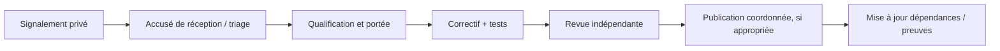

# Politique de sécurité — OSEF Payment & Banking Labs
# Security Policy — OSEF Payment & Banking Labs

**Version 1.0 — 17 novembre 2026 · Français / English**

> **Périmètre : LABORATOIRES UNIQUEMENT.** Ce dépôt sert à la formation, à l'expérimentation et à la contribution Open Source avec des données **entièrement synthétiques**. Il ne fournit pas de service bancaire, n'exécute aucun paiement réel et n'est pas homologué pour la production, par la BCEAO, PI-SPI ou PCI DSS.

## 1. Portée / Scope

Cette politique s'applique au **code, scripts, infrastructures de laboratoire, documentation, dépendances, modèles d'architecture, workflows CI et exemples** de ce dépôt.

| Élément | Couvert par cette politique ? | Conditions |
|---|---|---|
| Simulateurs et code OSEF dans ce dépôt | Oui | Versions identifiées, tests en lab |
| Exemples ISO 8583, API, wallet, ledger | Oui | Données synthétiques uniquement |
| Déploiements isolés Fineract / Mojaloop et composants tiers | Partie OSEF seulement | Les vulnérabilités du logiciel tiers relèvent aussi du canal amont |
| Diagrammes BDAT et architectures proposées | Analyse documentaire | Ne constituent pas une validation de sécurité |
| Plateformes bancaires, switches, réseaux de cartes, PI-SPI, clients d'OSEF | **Non** | Ne jamais les scanner, tester ou contacter sans mandat distinct |
| Environnements de production de tiers | **Non** | Aucune autorisation implicite |

**Versions prises en charge :** le dépôt ne publie actuellement **aucune version déclarée stable ou supportée en production**. Les labs en cours ne bénéficient d'aucun engagement de maintenance, de SLA ou de support de sécurité garanti. Les mainteneurs devront publier une politique de versions supportées lorsqu'une première version sera officiellement publiée.

## 2. Signalement privé d'une vulnérabilité / Private vulnerability reporting

**N'ouvrez pas d'issue publique, de discussion, de PR publique ou de commentaire divulguant des détails exploitables d'une vulnérabilité non corrigée. N'ajoutez jamais de preuve contenant des données réelles.**

1. Sur le dépôt, consultez l'onglet **Security → Advisories** et utilisez **« Report a vulnerability »** **si** le signalement privé GitHub est activé par les responsables.
2. Si ce bouton est absent ou indisponible, **ne publiez pas les détails**. Contactez les responsables du dépôt via un canal privé **dont l'authenticité est vérifiée** depuis leur profil officiel ou une communication officielle de l'organisation, afin de convenir d'un canal sécurisé. Aucun courriel ou formulaire privé n'est déclaré comme canal officiel dans ce document.
3. Pour une faille affectant directement un projet tiers (Apache Fineract, Mojaloop, Moov ISO8583, jPOS, etc.), suivez aussi **la procédure de signalement de sécurité du projet amont**. Ne créez pas une issue publique chez OSEF ou en amont pour exposer la faille.
4. Si vous constatez une **divulgation accidentelle de secret** sur GitHub, prévenez discrètement les responsables : la priorité est la **révocation/rotation par le détenteur du secret**, puis l'analyse des accès et la remédiation. La suppression d'un commit ne suffit pas à garantir l'effacement de ses copies.

**État opérationnel à vérifier :** l'activation de GitHub Private Vulnerability Reporting et la désignation d'un responsable sécurité OSEF **ne sont pas confirmées ici**. Il revient aux administrateurs du dépôt de les mettre en place et d'indiquer un canal fiable avant de promettre un processus de réponse.

### Informations utiles dans un rapport confidentiel
- Objet : composant, fichier / version / commit, prérequis.
- Nature du risque et impact **dans le seul laboratoire OSEF**.
- Étapes de reproduction minimales, non destructives, sans secret réel ni cible externe.
- Résultat attendu / observé, logs **expurgés** et éventuelle correction proposée.
- Indiquer si la vulnérabilité a déjà été communiquée au projet amont.
- Ne pas inclure de coordonnées personnelles sensibles non nécessaires.

## 3. Gestion des signalements / Vulnerability handling

**Workflow recommandé (à formaliser et à affecter à des responsables ; non présenté comme un engagement de service existant) :**

- **Triage :** vérifier le périmètre OSEF, reproductibilité, conditions d'exploitation, impact, correctifs déjà disponibles et dépendances affectées.
- **Priorisation :** considérer notamment divulgation de secrets, exécution de code, contournement d'authentification, compromission de CI et fuite de données.
- **Confinement :** isoler le lab, révoquer les secrets, désactiver un job risqué ou une intégration si nécessaire.
- **Correction :** privilégier une correction minimale, une version corrigée des dépendances, des tests de régression et une revue indépendante.
- **Communication :** publication après coordination raisonnable avec les personnes concernées et les mainteneurs amont, sans divulgation prématurée.
- **Traçabilité :** consigner l'issue non sensible et la résolution seulement après que l'information peut être rendue publique.

Aucun délai de réponse ou de résolution garanti n'est en vigueur. Tout engagement futur devra être publié après désignation d'un responsable et validation de la capacité opérationnelle.

## 4. Règles strictes pour les labs bancaires et de paiement

### Données interdites
**Ne jamais collecter, importer, committer, afficher en capture ni publier :**
- PAN de cartes réels, numéros complets même de test provenant de réseaux réels, pistes magnétiques, PIN, CVV/CVC, cryptogrammes, clés HSM et données EMV sensibles.
- Numéros de comptes / IBAN réels, relevés, soldes de clients, identités et données personnelles ou financières réelles.
- Tokens, cookies de session, mots de passe, certificats privés, secrets d'API, clés de chiffrement ou fichiers `.env` renseignés.
- Logs d'infrastructures clients, adresses internes confidentielles, schémas privés de réseaux de paiement ou documentation contractuellement restreinte.
- Jeux de données prétendument « anonymisés » sans validation : une anonymisation imparfaite ne les rend pas nécessairement publics.

### Données autorisées
- Personnages, institutions, comptes et portefeuilles **entièrement inventés**, sans lien avec une personne ou un instrument financier réel.
- Identifiants explicitement non routables et valeurs artificielles conçues pour les tests.
- Mock APIs, simulateurs et événements fictifs, avec avertissement visible `LAB ONLY`.
- Secrets de développement à usage local, éphémères et non partagés, **jamais dans Git**.

### Connectivité et contrôle des accès
- Lab **isolé par défaut** ; pas de VPN bancaire, tunnel vers une institution, terminal TPE réel, HSM réel ou réseau de paiement.
- Pas de scan, fuzzing ou test de charge contre un service tiers sans **autorisation écrite explicite**, périmètre et fenêtre approuvés.
- Comptes et droits minimaux, authentification appropriée pour les interfaces exposées, restrictions réseau et absence d'exposition publique involontaire.
- Ne pas exposer de console d'administration, API sensible ou base de données à Internet par défaut.
- Les téléchargements de paquets publics nécessaires au développement doivent être distingués de toute connexion à un service financier.

## 5. Contrôles techniques attendus / Security baseline

| Domaine | Mesures attendues pour les contributions | État |
|---|---|---|
| Code et PR | Revue indépendante, tests nominaux et négatifs, contrôle des changements | À vérifier par PR |
| Dépendances | Versions figées, provenance, licence, suivi des avis et mises à jour | À mettre en œuvre lab par lab |
| Secrets | `.gitignore`, variables injectées localement, détection de secrets avant fusion | Configuration automatique non confirmée |
| CI / GitHub Actions | Permissions minimales, actions épinglées, pas de secrets pour code non fiable, contrôle de supply chain | Configuration à auditer |
| Conteneurs et VM | Images traçables, versions figées, utilisateurs non privilégiés si possible, nettoyage et patching | À définir par lab |
| API | Authentification, autorisation, validation des entrées, rate limits et erreurs sans fuite | À démontrer par tests |
| Paiements / messages | Idempotence, rejets, gestion du timeout, exactitude des états, logs sans champs sensibles | À démontrer par lab |
| Observabilité | Traces et métriques expurgées, contrôles d'accès aux tableaux, conservation limitée | À démontrer |
| Architecture | Hypothèses explicites, threat model, frontières de confiance, revue BDAT | À compléter |

**Important :** cette table définit des **exigences visées**, pas des contrôles déjà activés dans le dépôt. En particulier, l'existence de GitHub Actions, Dependabot, CodeQL, secret scanning, règles de protection de branche ou d'un processus d'astreinte doit être confirmée séparément.

## 6. Analyse des menaces spécifique aux paiements / Threat modeling

Pour toute nouvelle architecture ([catalogue BDAT](docs/architecture/blueprints/BDAT-README.md)), identifier au minimum :
- Actifs : secrets de lab, intégrité des messages, écritures, résultats de test, artefacts et logs.
- Frontières de confiance : canaux fictifs, passerelle API, IAM, adaptateurs, ledger et environnements CI.
- Risques d'intégrité : doublon, rejeu, modification de montant, désynchronisation, mismatch de messages, état final incorrect.
- Risques de disponibilité : surcharge, latence, panne de dépendance, timeout, retry sans borne, reprise incorrecte.
- Risques de confidentialité : journalisation excessive, dépendances malveillantes, artefacts et tokens de CI.
- Mesures : validation des entrées, authentification/autorisation, idempotence, journalisation expurgée, tests négatifs et analyse des dépendances.

Les simulations de flux financiers ne constituent **pas** une validation des contrôles de fraude, AML/KYC, EMV, PCI DSS ou de conformité BCEAO/PI-SPI.

## 7. En cas d'incident ou de secret exposé / Incident response

1. **Stopper** immédiatement toute publication ou automatisation qui propagerait l'information.
2. **Isoler** l'environnement touché si vous en avez l'autorisation, sans effacer les preuves utiles.
3. **Signaler en privé** selon la section 2; ne pas reposter les éléments sensibles dans GitHub.
4. **Révoquer/faire révoquer** rapidement par le propriétaire les tokens ou clés exposés; remplacer les identifiants et évaluer les accès.
5. **Évaluer et corriger** la cause, mettre à jour les dépendances et tests.
6. **Documenter** un compte rendu expurgé après validation de la divulgation.

Ne prétendez pas que la suppression d'un fichier GitHub, la réécriture d'historique ou l'expiration d'une clé a suffi à neutraliser un incident sans vérification.

## 8. Responsabilités et divulgation / Responsibilities

- **Contributeur :** ne soumettre que des données fictives, minimiser l'exposition, signaler discrètement les vulnérabilités, respecter les permissions.
- **Mainteneur :** instruire les signalements reçus, vérifier les dépendances, contrôler les PR et coordonner les corrections selon ses moyens.
- **Responsable sécurité (à désigner) :** définir le canal privé, la gravité, les délais de service réalistes, la communication et la coordination upstream.
- **Propriétaire d'un système tiers :** seul habilité à autoriser les tests et à conduire la remédiation sur son environnement.

**Règle de publication :** pas de preuve d'exploitation détaillée ou de données confidentielles sans validation des personnes responsables, et jamais de secrets ou données financières réelles dans les artefacts publics.

## 9. Références et documentation

- [Contributing](CONTRIBUTING.md)
- [Architecture de référence](docs/architecture/README.md)
- [Blueprints BDAT](docs/architecture/blueprints/BDAT-README.md)
- [GitHub — Private vulnerability reporting](https://docs.github.com/en/code-security/security-advisories/working-with-repository-security-advisories/configuring-private-vulnerability-reporting-for-a-repository)
- [OWASP ASVS](https://owasp.org/www-project-application-security-verification-standard/)
- [OWASP API Security Top 10](https://owasp.org/API-Security/)
- [OpenSSF Best Practices](https://www.bestpractices.dev/)

---

## English — Security policy summary

This repository is **for isolated educational payment and banking labs only**. No live banking infrastructure, real customer/card data, payment execution, confidential financial information or unauthorized testing is permitted.

**Report vulnerabilities privately.** Use GitHub **Security → Advisories → Report a vulnerability** only **if the feature is enabled**. If unavailable, do not disclose sensitive details publicly; contact the repository maintainers through a privately verified channel. No official security email or guaranteed response time is currently published here.

Use synthetic datasets, least privilege, isolated runtimes, dependency pinning, sanitized logs and independent review. Upstream vulnerabilities should also follow the affected upstream project's security reporting process.

The security controls in this policy are **targets**, not claims that they are implemented. A successful lab is not a certified, production-ready, PCI DSS compliant or BCEAO/PI-SPI approved financial system.
