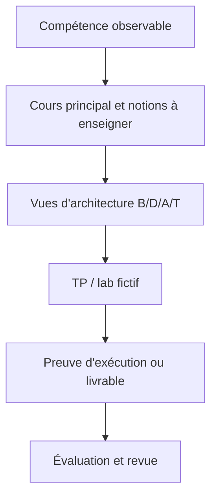

# OSEF Academy — Correspondance compétences professionnelles ↔ cours ↔ travaux pratiques

**Référentiel pédagogique proposé v0.1 — 17 novembre 2026**  
**Périmètre :** 21 unités existantes : 7 cours du tronc commun, 6 cours de monétique et 8 cours de paiement numérique et d'interopérabilité.

> **Important :** les intitulés des cours et les fiches existantes sont issus du cursus public OSEF. Les colonnes « notions du cours » ci-dessous constituent un **syllabus de consolidation proposé** : elles détaillent ce qui devrait être enseigné, sans affirmer que toutes les leçons, vidéos, TP et évaluations correspondants sont déjà disponibles. Aucun cursus confidentiel OPPL n'est reproduit. Les labs sont exclusivement fictifs et non certifiants.

## Règle pédagogique fondamentale

**Une compétence est ce que l'apprenant doit pouvoir faire ; un cours est ce qui lui permet de l'apprendre ; un TP/lab est ce qui permet de la mettre en pratique ; une évaluation est ce qui permet de vérifier son acquisition.**

Un même cours peut renforcer plusieurs compétences, et une compétence peut nécessiter plusieurs cours. Les liaisons ci-dessous désignent le **cours principal** associé à la compétence, pas une équivalence exclusive.

## Tronc commun

| Compétence observable | Cours de référence | Notions à enseigner (syllabus proposé) | TP / lab associé | Référence BDAT | Évaluation de l'acquis |
|---|---|---|---|---|---|
| **Préparer un environnement reproductible et collaborer par Git** | [TC-01 — Environnement technique et Git](tronc-commun/TC-01-SYSTEMES-ET-GIT.md) | Système d’exploitation et shell ; répertoire de travail isolé ; Git, branches et commits ; licences et dépendances ; documentation README ; commandes et scripts commentés | TC-01 | ARC-10 T/A | Empreinte déterministe, historique Git, README et commandes réellement exécutées |
| **Concevoir et vérifier un contrat d'API** | [TC-02 — Réseaux, HTTP et contrats d'API](tronc-commun/TC-02-RESEAUX-API-ET-CONTRATS.md) | Ports, DNS et TLS ; méthodes et codes HTTP ; JSON et schémas ; OpenAPI comme contrat à produire ; réponses d’erreur ; validation et mocks | TC-02 / OPB-009 | ARC-05 A/T | Contrat API fictif et tests d'entrées valides/invalides |
| **Expliquer le parcours métier d'une opération de paiement** | [TC-03 — Fondamentaux des systèmes de paiement](tronc-commun/TC-03-METIERS-ET-CYCLE-PAIEMENT.md) | Acteurs et rôles ; ordre de paiement ; états et transitions ; autorisation, compensation et règlement comme concepts distincts ; exceptions ; limites de simulation | TC-03 / OPB-001 | ARC-03 B/D | Séquence métier annotée, glossaire et gestion d'un état inconnu |
| **Modéliser les données financières synthétiques et leurs invariants** | [TC-04 — Modélisation de données et cohérence transactionnelle](tronc-commun/TC-04-DONNEES-ET-COHERENCE.md) | Identifiants métier/techniques ; modèle de ledger fictif ; écritures équilibrées ; idempotence et déduplication ; journaux ; rapprochement et écarts | TC-04 / OPB-015 | ARC-06 D/A | Jeu synthétique, invariant d'équilibre et test de rejeu |
| **Identifier les risques et protéger les interfaces** | [TC-05 — Sécurité des systèmes et interfaces de paiement](tronc-commun/TC-05-SECURITE-ET-CONFIANCE.md) | Identité, authentification, autorisation ; scopes et moindre privilège ; TLS et gestion des secrets ; frontières de confiance ; journalisation expurgée ; conformité à examiner | TC-05 / OPB-010 | ARC-08 B/A/T | Threat model, refus d'accès et logs sans secrets |
| **Tester les anomalies et diagnostiquer un état incertain** | [TC-06 — Tests, observabilité et résilience](tronc-commun/TC-06-QUALITE-ET-RESILIENCE.md) | Tests unitaires et de contrat ; scénarios de rejet, timeout et doublon ; métriques, traces et corrélation ; reprise et runbook ; différence attendu/observé | TC-06 / OPB-017 | ARC-09 A/T/D | Matrice de tests, scénario timeout et runbook |
| **Justifier une architecture de paiement et contribuer à un projet OSS** | [TC-07 — Architecture BDAT et ingénierie Open Source](tronc-commun/TC-07-ARCHITECTURE-ET-OPEN-SOURCE.md) | Vues Business/Data/Application/Technology ; interfaces et ADR ; licences et provenance ; contribution GitHub ; revue et gestion des limites | TC-07 / OPB-020 | ARC-10 B/D/A/T | Quatre vues commentées, ADR, licence examinée et PR |

**Statut du groupe :** 7 fiches pédagogiques documentées ; l'enseignement effectif de chaque notion et la réussite des TP doivent être vérifiés individuellement.

## Spécialité A — Monétique

| Compétence observable | Cours de référence | Notions à enseigner (syllabus proposé) | TP / lab associé | Référence BDAT | Évaluation de l'acquis |
|---|---|---|---|---|---|
| **Expliquer les acteurs et le parcours d'une opération carte fictive** | [MON-01 — Écosystème monétique et flux de paiement carte](monetique-iso8583/01-ECOSYSTEME-ET-FLUX.md) | Porteur, marchand, acquéreur, émetteur, switch comme rôles ; demande et réponse d'autorisation fictive ; refus ; événement incertain ; frontière entre simulation et chaîne financière réelle | OPB-D03-001 (documentation) | ARC-02 B | Diagramme de séquence et glossaire monétique |
| **Lire et expliquer un message ISO 8583 selon un profil donné** | [MON-02 — Structure des messages ISO 8583](monetique-iso8583/02-STRUCTURE-MESSAGE-ISO8583.md) | MTI ; bitmap ; définitions des champs ; formats et longueurs ; encodage ; variations des spécifications et limites des profils | OPB-D03-001 | ARC-02 D | Dictionnaire des champs fictifs, contraintes et schéma de message |
| **Programmer et tester l'encodage/décodage d'un message fictif** | [MON-03 — Programmation monétique avec Go](monetique-iso8583/03-PACK-UNPACK-GO.md) | Module Go et dépendances ; spécification éducative choisie ; construction du message ; Pack/Unpack ; tests unitaires et reproductibilité | OPB-D03-001 | ARC-02 A/T | Code et tests Go réellement exécutés avec versions consignées |
| **Distinguer refus, erreur de format, timeout et doublon** | [MON-04 — Gestion des exceptions monétiques](monetique-iso8583/04-CAS-NEGATIFS-ET-ETATS.md) | Trame tronquée ; champ incompatible ; réponse fictive ; machine à états ; idempotence ; résolution d'une absence de réponse ; limites des reversals fictifs | OPB-D03-001 | ARC-02 D/A | Matrice de tests négatifs, transitions et résultats observés |
| **Analyser les risques et rendre un composant monétique observable** | [MON-05 — Sécurité et supervision monétique](monetique-iso8583/05-SECURITE-ET-OBSERVABILITE.md) | Modèle de menace ; frontières de confiance ; minimisation des données ; logs ; indicateurs et corrélation ; limites HSM/EMV/PKI du simulateur | OPB-D03-001 / OPB-016 | ARC-08 A/T | Threat model, schéma des logs et des métriques |
| **Démontrer et faire relire une solution de test monétique** | [MON-06 — Intégration et revue technique monétique](monetique-iso8583/06-INTEGRATION-ET-REVUE.md) | Contrats de simulation ; architecture ARC-02 ; stratégie de tests ; décisions techniques ; documentation d'installation ; démonstration et revue de PR | OPB-D03-001 | ARC-10 B/D/A/T | Dossier de démonstration, tests, ADR et revue |

**Statut du groupe :** 6 fiches pédagogiques documentées ; l'enseignement effectif de chaque notion et la réussite des TP doivent être vérifiés individuellement.

## Spécialité B — Paiements numériques et interopérabilité

| Compétence observable | Cours de référence | Notions à enseigner (syllabus proposé) | TP / lab associé | Référence BDAT | Évaluation de l'acquis |
|---|---|---|---|---|---|
| **Cartographier un paiement numérique entre participants fictifs** | [PNI-01 — Écosystème des paiements numériques](paiements-numeriques-interoperabilite/01-ACTEURS-ET-CYCLE.md) | Participants et rôles ; transfert simulé ; cycle de vie ; succès, rejet, timeout et incertitude ; interopérabilité comme objectif architectural | OPB-005 / OPB-007 | ARC-03 B/D | Diagramme des participants, séquences et états |
| **Concevoir une API de paiement fictive sécurisable** | [PNI-02 — Ingénierie des API de paiement](paiements-numeriques-interoperabilite/02-API-PAIEMENT.md) | Contrats OpenAPI ; endpoints de création et consultation ; erreurs ; identifiants ; contrôle d'accès ; clé d'idempotence ; mocks et tests | OPB-009 | ARC-05 A/D | OpenAPI, mock, erreurs et tests de requêtes |
| **Définir des wallets et vérifier la cohérence d'écritures** | [PNI-03 — Wallets, ledger et rapprochement](paiements-numeriques-interoperabilite/03-WALLET-ET-LEDGER.md) | Modèle wallet fictif ; ordre et solde ; écriture équilibrée ; idempotence ; incohérences ; rapprochement et traçabilité | OPB-015 / lab wallet à proposer | ARC-04 B/D/A + ARC-06 D | Jeu d'écritures synthétiques, invariants et rapport d'écarts |
| **Intégrer deux institutions simulées par contrats vérifiables** | [PNI-04 — Architecture de l'interopérabilité](paiements-numeriques-interoperabilite/04-INTEROPERABILITE.md) | Participants, adaptateurs et hub ; messages et notifications ; corrélation ; statuts ; rejets, doublons et réponses tardives ; séparation du règlement réel | OPB-005 à OPB-008 | ARC-03 D/A/T | Contrats versionnés et scénarios de transferts simulés |
| **Coordonner des opérations fictives et leurs événements** | [PNI-05 — Orchestration et événements de paiement](paiements-numeriques-interoperabilite/05-EVENEMENTS-ET-ORCHESTRATION.md) | Orchestrateur ; événements, commandes et schémas ; ordre/rejeu ; idempotence ; notifications ; panne de worker ; choix d'architecture | OPB-009 / OPB-013 | ARC-07 D/A | Contrats événementiels, tests de redelivery et ADR |
| **Définir et vérifier les contrôles de sécurité d'une plateforme fictive** | [PNI-06 — Sécurité des API et des échanges](paiements-numeriques-interoperabilite/06-SECURITE.md) | IAM ; scopes ; politique d'autorisation ; confidentialité ; gestion des secrets ; threat model ; règles antifraude simulées ; traçabilité | OPB-010 à OPB-012 / OPB-019 | ARC-08 B/A/T | Contrôles d'accès, modèle de menace et logs expurgés |
| **Observer et diagnostiquer les incidents d'un flux interopérable** | [PNI-07 — Fiabilité et observabilité des paiements](paiements-numeriques-interoperabilite/07-RESILIENCE.md) | Corrélation ; métriques et traces ; timeout ; état indéterminé ; retries ; incidents ; runbook ; vérification avant compensation | OPB-014 / OPB-016 / OPB-017 | ARC-09 D/A/T | Scénarios de panne, traces et runbook testé |
| **Concevoir, démontrer et défendre une plateforme simulée** | [PNI-08 — Projet intégrateur d'ingénierie des paiements](paiements-numeriques-interoperabilite/08-CAPSTONE.md) | API et orchestrateur ; deux participants mockés ; ledger ; observabilité ; sécurité ; cas nominaux et dégradés ; BDAT et soutenance | OPB-020 (proposé) | ARC-03 + ARC-10 B/D/A/T | Code, schémas, tests exécutés, ADR et revue indépendante |

**Statut du groupe :** 8 fiches pédagogiques documentées ; l'enseignement effectif de chaque notion et la réussite des TP doivent être vérifiés individuellement.

## Exemple de lecture : compétence « maîtriser l'idempotence »

- **Compétence :** prévenir l'application multiple d'un même ordre fictif.
- **Cours principal :** [TC-04 — Modélisation de données et cohérence transactionnelle](tronc-commun/TC-04-DONNEES-ET-COHERENCE.md).
- **Cours d'approfondissement :** [PNI-03 — Wallets, ledger et rapprochement](paiements-numeriques-interoperabilite/03-WALLET-ET-LEDGER.md), puis [PNI-05 — Orchestration et événements](paiements-numeriques-interoperabilite/05-EVENEMENTS-ET-ORCHESTRATION.md).
- **Architecture :** [ARC-06-D](../architecture/blueprints/ARC-06-D.md) et [ARC-07-A](../architecture/blueprints/ARC-07-A.md).
- **Exercice :** rejouer la même référence fictive, puis tester une même clé avec une charge différente.
- **Preuve :** démonstration reproduite, état avant/après, résultat de test, limites et revue.

## Exigences minimales pour construire une véritable fiche de cours

Pour chaque cours TC, MON ou PNI, compléter progressivement :

1. **Compétence cible :** verbe d'action observable et périmètre précis.
2. **Objectifs pédagogiques :** de 3 à 5 acquis vérifiables, distincts de l'intitulé général.
3. **Prérequis :** notions, outils et cours antérieurs nécessaires.
4. **Plan de cours :** notions, démonstrations et ressources **effectivement disponibles**.
5. **Exercice guidé :** sujet, environnement fictif, données, commandes commentées et attendus.
6. **Évaluation :** critères d'acceptation, épreuve théorique et/ou pratique, preuves réelles.
7. **Ressources :** sources officielles vérifiées, versions, licences et limites.
8. **Statut :** à rédiger / rédigé / relu / enseigné / TP exécuté / acquis évalué ; ces états doivent être établis séparément.

## Ce qui est déjà disponible et ce qui manque

| Élément | Statut documenté |
|---|---|
| Structure des 21 modules et objectifs | **Documentée** dans les trois parcours |
| Vues BDAT ARC-01 à ARC-10 | **40 vues conceptuelles proposées** |
| Mini-labs TC-01 à TC-07 | Code et tests documentés ; **succès d'exécution à confirmer** |
| Lab monétique OPB-D03-001 | Prototype publié ; **compilation et résultats Go non confirmés** |
| Autres labs OPB | Majoritairement **sujets à réaliser**, pas exécutions attestées |
| Syllabus détaillé notion par notion | **Proposé dans cette correspondance** ; cours complets et ressources à compléter |
| Validation de l'acquisition de compétences | **Non confirmée** : pas d'attestation ni de certification établie |

## Ressources liées

- [Cursus général](PARCOURS-INGENIEUR-MONETIQUE-PAIEMENT-OSEF.md)
- [Matrice compétences × BDAT × labs × preuves](MATRICE-COMPETENCES-BDAT-LABS.md)
- [Catalogue des laboratoires](../../labs/README.md)
- [Modèle de preuve de compétence](MODELE-PREUVE-COMPETENCE.md)
- [Sécurité](../../SECURITY.md)

**English summary:** Proposed competency-to-course mapping for the 21 OSEF learning units. It distinguishes existing course outline files from proposed lesson syllabi, executable labs and verified outcomes.
