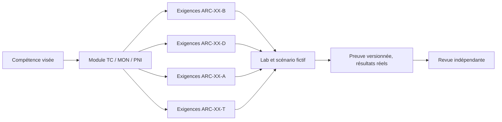

# Matrice de traçabilité — Compétences × Architectures BDAT × Labs × Preuves

**OSEF Academy — Proposition de référentiel pédagogique v0.1, 17 novembre 2026**  
**Couverture : 7 modules de tronc commun + 6 modules monétiques + 8 modules paiements numériques = 21 unités.**

> Cette matrice **propose** des correspondances pédagogiques entre les modules de formation et les architectures **conceptuelles** du dépôt. Elle ne démontre ni réussite de lab, ni couverture exhaustive d'une norme, ni habilitation à exercer une activité financière. Elle repose exclusivement sur les modules, blueprints, vues BDAT et descriptions de labs **publics du dépôt OSEF** et ne diffuse pas de supports confidentiels OPPL.

## 1. Chaîne de traçabilité

**Règle de lecture :** les vues indiquées sont les **vues principales** à étudier ; les autres vues peuvent être nécessaires. Une architecture « support » ne se substitue pas au manuel, à une spécification de protocole ou à une preuve technique. Les lignes ci-dessous ne valent pas déclaration d'achèvement.

## Tronc commun (7)

| Module et fiche | Compétence observable proposée | Architecture | Vues prioritaires | Lab / sujet associé | Preuve exigée |
|---|---|---|---|---|---|
| [TC-01](tronc-commun/TC-01-SYSTEMES-ET-GIT.md) | Versionner un environnement et reproduire une expérience | [ARC-10](../architecture/blueprints/ARC-10.md) | [T](../architecture/blueprints/ARC-10-T.md) · [A](../architecture/blueprints/ARC-10-A.md) | TC-01 | README, hash SHA-256, version Python, commande et preuve d'exécution |
| [TC-02](tronc-commun/TC-02-RESEAUX-API-ET-CONTRATS.md) | Définir API, statuts et contrats | [ARC-05](../architecture/blueprints/ARC-05.md) | [A](../architecture/blueprints/ARC-05-A.md) · [T](../architecture/blueprints/ARC-05-T.md) | TC-02 / OPB-009 | Contrat fictif, requêtes valides et invalides et résultats observés |
| [TC-03](tronc-commun/TC-03-METIERS-ET-CYCLE-PAIEMENT.md) | Expliquer acteurs et étapes d'un paiement fictif | [ARC-03](../architecture/blueprints/ARC-03.md) | [B](../architecture/blueprints/ARC-03-B.md) · [D](../architecture/blueprints/ARC-03-D.md) | TC-03 / OPB-001 | Diagramme de séquence, glossaire, état incertain correctement décrit |
| [TC-04](tronc-commun/TC-04-DONNEES-ET-COHERENCE.md) | Contrôler équilibre, identifiants et doublons | [ARC-06](../architecture/blueprints/ARC-06.md) | [D](../architecture/blueprints/ARC-06-D.md) · [A](../architecture/blueprints/ARC-06-A.md) | TC-04 / OPB-015 | Invariant d'équilibre, rejeu idempotent, test négatif consigné |
| [TC-05](tronc-commun/TC-05-SECURITE-ET-CONFIANCE.md) | Définir accès, frontières de confiance et secrets | [ARC-08](../architecture/blueprints/ARC-08.md) | [B](../architecture/blueprints/ARC-08-B.md) · [A](../architecture/blueprints/ARC-08-A.md) · [T](../architecture/blueprints/ARC-08-T.md) | TC-05 / OPB-010 | Modèle de menace, contrôle d'accès, log expurgé |
| [TC-06](tronc-commun/TC-06-QUALITE-ET-RESILIENCE.md) | Tester panne, timeout, état et reprise | [ARC-09](../architecture/blueprints/ARC-09.md) | [A](../architecture/blueprints/ARC-09-A.md) · [T](../architecture/blueprints/ARC-09-T.md) · [D](../architecture/blueprints/ARC-09-D.md) | TC-06 / OPB-017 | Matrice de tests, état UNKNOWN, runbook et traces fictives |
| [TC-07](tronc-commun/TC-07-ARCHITECTURE-ET-OPEN-SOURCE.md) | Relier B, D, A, T et argumenter les choix techniques | [ARC-10](../architecture/blueprints/ARC-10.md) | [B](../architecture/blueprints/ARC-10-B.md) · [D](../architecture/blueprints/ARC-10-D.md) · [A](../architecture/blueprints/ARC-10-A.md) · [T](../architecture/blueprints/ARC-10-T.md) | TC-07 / OPB-020 | Quatre vues commentées, ADR, revue de licence et PR |

## Spécialité monétique et ISO 8583 (6)

| Module et fiche | Compétence observable proposée | Architecture | Vues prioritaires | Lab / sujet associé | Preuve exigée |
|---|---|---|---|---|---|
| [MON-01](monetique-iso8583/01-ECOSYSTEME-ET-FLUX.md) | Modéliser les acteurs et le cycle carte fictif | [ARC-02](../architecture/blueprints/ARC-02.md) | [B](../architecture/blueprints/ARC-02-B.md) | OPB-D03-001 (documentation) | Rôles émetteur/acquéreur, diagramme, événements et limites |
| [MON-02](monetique-iso8583/02-STRUCTURE-MESSAGE-ISO8583.md) | Identifier MTI, bitmap, champs et profil de message | [ARC-02](../architecture/blueprints/ARC-02.md) | [D](../architecture/blueprints/ARC-02-D.md) | OPB-D03-001 | Dictionnaire de champs fictifs, encodage et contraintes de profil |
| [MON-03](monetique-iso8583/03-PACK-UNPACK-GO.md) | Programmer un aller-retour ISO 8583 synthétique | [ARC-02](../architecture/blueprints/ARC-02.md) | [A](../architecture/blueprints/ARC-02-A.md) · [T](../architecture/blueprints/ARC-02-T.md) | OPB-D03-001 | Go module/version figés, preuve réelle go test et Pack/Unpack |
| [MON-04](monetique-iso8583/04-CAS-NEGATIFS-ET-ETATS.md) | Tester erreurs, doublons et états indéterminés | [ARC-02](../architecture/blueprints/ARC-02.md) | [D](../architecture/blueprints/ARC-02-D.md) · [A](../architecture/blueprints/ARC-02-A.md) | OPB-D03-001 | Matrice résultat attendu/observé, tests négatifs et transition d'état |
| [MON-05](monetique-iso8583/05-SECURITE-ET-OBSERVABILITE.md) | Identifier risques monétiques et traces non sensibles | [ARC-08](../architecture/blueprints/ARC-08.md) | [A](../architecture/blueprints/ARC-08-A.md) · [T](../architecture/blueprints/ARC-08-T.md) | OPB-D03-001 / OPB-016 | Threat model, politique de logs et limites de la simulation |
| [MON-06](monetique-iso8583/06-INTEGRATION-ET-REVUE.md) | Revoir une solution monétique de laboratoire | [ARC-10](../architecture/blueprints/ARC-10.md) | [B](../architecture/blueprints/ARC-10-B.md) · [D](../architecture/blueprints/ARC-10-D.md) · [A](../architecture/blueprints/ARC-10-A.md) · [T](../architecture/blueprints/ARC-10-T.md) | OPB-D03-001 | BDAT révisé, démonstration, PR et rapport de revue |

## Spécialité paiements numériques et interopérabilité (8)

| Module et fiche | Compétence observable proposée | Architecture | Vues prioritaires | Lab / sujet associé | Preuve exigée |
|---|---|---|---|---|---|
| [PNI-01](paiements-numeriques-interoperabilite/01-ACTEURS-ET-CYCLE.md) | Identifier participants et étapes du paiement numérique | [ARC-03](../architecture/blueprints/ARC-03.md) | [B](../architecture/blueprints/ARC-03-B.md) · [D](../architecture/blueprints/ARC-03-D.md) | OPB-005 / OPB-007 | Séquences métier, états et scénarios d'exception |
| [PNI-02](paiements-numeriques-interoperabilite/02-API-PAIEMENT.md) | Définir API de paiement fictive | [ARC-05](../architecture/blueprints/ARC-05.md) | [A](../architecture/blueprints/ARC-05-A.md) · [D](../architecture/blueprints/ARC-05-D.md) | OPB-009 | OpenAPI, mocks, erreurs, contrôle d'accès |
| [PNI-03](paiements-numeriques-interoperabilite/03-WALLET-ET-LEDGER.md) | Modéliser wallet, journal et rapprochement | [ARC-04](../architecture/blueprints/ARC-04.md) | [B](../architecture/blueprints/ARC-04-B.md) · [D](../architecture/blueprints/ARC-04-D.md) · [A](../architecture/blueprints/ARC-04-A.md) | OPB-015 / lab wallet à proposer | Modèle de wallet, écritures fictives et test d'équilibre |
| [PNI-04](paiements-numeriques-interoperabilite/04-INTEROPERABILITE.md) | Intégrer deux participants mockés | [ARC-03](../architecture/blueprints/ARC-03.md) | [D](../architecture/blueprints/ARC-03-D.md) · [A](../architecture/blueprints/ARC-03-A.md) · [T](../architecture/blueprints/ARC-03-T.md) | OPB-005 à OPB-008 | Contrats versionnés, identifiants, statuts, tests de transfert fictif |
| [PNI-05](paiements-numeriques-interoperabilite/05-EVENEMENTS-ET-ORCHESTRATION.md) | Orchestrer les étapes et notifications fictives | [ARC-07](../architecture/blueprints/ARC-07.md) | [D](../architecture/blueprints/ARC-07-D.md) · [A](../architecture/blueprints/ARC-07-A.md) | OPB-009 / OPB-013 | Événements versionnés, rejouabilité, ADR et preuves de tests |
| [PNI-06](paiements-numeriques-interoperabilite/06-SECURITE.md) | Sécuriser interfaces et consentement simulé | [ARC-08](../architecture/blueprints/ARC-08.md) | [B](../architecture/blueprints/ARC-08-B.md) · [A](../architecture/blueprints/ARC-08-A.md) · [T](../architecture/blueprints/ARC-08-T.md) | OPB-010 à OPB-012 / OPB-019 | Threat model, accès autorisé/refusé, logs expurgés |
| [PNI-07](paiements-numeriques-interoperabilite/07-RESILIENCE.md) | Suivre états, métriques et incidents | [ARC-09](../architecture/blueprints/ARC-09.md) | [D](../architecture/blueprints/ARC-09-D.md) · [A](../architecture/blueprints/ARC-09-A.md) · [T](../architecture/blueprints/ARC-09-T.md) | OPB-014 / OPB-016 / OPB-017 | Traces corrélées, tests timeout/doublon et runbook |
| [PNI-08](paiements-numeriques-interoperabilite/08-CAPSTONE.md) | Démontrer une plateforme de paiements fictifs | [ARC-10](../architecture/blueprints/ARC-10.md) | [B](../architecture/blueprints/ARC-10-B.md) · [D](../architecture/blueprints/ARC-10-D.md) · [A](../architecture/blueprints/ARC-10-A.md) · [T](../architecture/blueprints/ARC-10-T.md) | OPB-020 (proposé) | Architecture, API, participants mockés, ledger, tests, soutenance |

## 2. Parcours de preuve proposé par niveau

| Étape | Travail de l'apprenant | Évidence | État de validation |
|---|---|---|---|
| **Lire** | Expliquer un schéma B/D/A/T et ses limites | Fiche sourcée et diagramme annoté | **Documenté**, ne signifie pas exécuté |
| **Concevoir** | Formaliser cas d'usage, contrats, données, sécurité et critères | ADR, OpenAPI ou dictionnaire, scénarios négatifs | **Soumis**, en attente de revue |
| **Construire** | Développer et instrumenter un mock isolé | Code versionné, versions et scripts commentés | **Construit**, pas nécessairement testé |
| **Tester** | Exécuter réellement les cas nominaux et dégradés | Commandes, date, sorties expurgées, résultats OK/KO | **Testé**, sous réserve de preuve |
| **Réviser** | Traiter une revue indépendante | PR, commentaires, corrections, décision | **Revu** après preuve du contrôle |
| **Valider en lab** | Vérifier les exigences acceptées pour le module | Checklist, lien vers preuves et décision nominative | Ne vaut jamais certification, homologation ou production |

**Aucun statut par apprenant ou lab n'est encore attribué dans ce document.** Les référents et les règles de passage doivent être approuvés par la gouvernance OSEF. Une preuve d'échec documentée est préférable à une réussite prétendue.

## 3. Quatre contrôles transversaux indispensables

- **Business → Data :** les données et états sont-ils justifiés par les actes métiers réellement simulés ?
- **Data → Application :** les contrats, idempotence et écritures respectent-ils le dictionnaire de données ?
- **Application → Technology :** les versions, ressources, secrets, ports et composants sont-ils documentés et réellement testés ?
- **Technology → Business :** les limites, incidents et risques identifiés sont-ils compréhensibles par l'utilisateur métier ?

## 4. Projets évaluateurs proposés

| Parcours | Architecture primaire | Architectures complémentaires | Démonstration attendue |
|---|---|---|---|
| Tronc commun | [ARC-10](../architecture/blueprints/ARC-10.md) | [ARC-05](../architecture/blueprints/ARC-05.md), [ARC-06](../architecture/blueprints/ARC-06.md), [ARC-09](../architecture/blueprints/ARC-09.md) | Contrat fictif, petit journal, tests nominaux/négatifs et documentation |
| Ingénieur monétique | [ARC-02](../architecture/blueprints/ARC-02.md) | [ARC-08](../architecture/blueprints/ARC-08.md), [ARC-09](../architecture/blueprints/ARC-09.md), [ARC-10](../architecture/blueprints/ARC-10.md) | Construction/décodage ISO 8583 fictif, erreurs et preuve de tests |
| Paiements numériques | [ARC-03](../architecture/blueprints/ARC-03.md) | [ARC-04](../architecture/blueprints/ARC-04.md), [ARC-05](../architecture/blueprints/ARC-05.md), [ARC-06](../architecture/blueprints/ARC-06.md), [ARC-07](../architecture/blueprints/ARC-07.md), [ARC-09](../architecture/blueprints/ARC-09.md) | Deux participants simulés, API, états, doublons, rapprochement et supervision |

## 5. Registre des lacunes à combler

| Lacune documentée | Risque pédagogique | Action proposée |
|---|---|---|
| Vues BDAT conceptuelles, relations simplifiées | Confondre schéma et implémentation | Documenter contrats, séquences, états et décision d'architecture |
| Prototype ISO 8583 non attesté comme compilé/testé | Attribuer des compétences sans preuve | Exécuter et publier `go test`, versions, erreurs réelles, revue |
| Plusieurs labs OPB seulement au stade de proposition | Parcours non exécutable de bout en bout | Créer des issues et guides de lab autonomes, d'abord API/ledger puis transfert |
| Validation des mini-labs Python non confirmée par CI | Faux sentiment de maturité | Vérifier exécutions réelles, logs CI et signatures de revue |
| Barèmes pédagogiques non approuvés | Confusion avec certification | Faire approuver critères, responsabilités et règles de décision |
| Versions/licences de technologies candidates à vérifier | Risque juridique et de compatibilité | Vérification à la source avant toute intégration |

## 6. Template pour chaque compétence à évaluer

Consulter [MODELE-PREUVE-COMPETENCE.md](MODELE-PREUVE-COMPETENCE.md) : la preuve associe un **module + un ID d'exigence BDAT + un scénario + un artefact exécuté + une revue**.

## Sources internes et règles

- [Catalogue des 40 vues B/D/A/T](../architecture/blueprints/BDAT-4-VUES-README.md)
- [Tronc commun](tronc-commun/README.md)
- [Spécialité monétique](monetique-iso8583/README.md)
- [Spécialité paiement numérique](paiements-numeriques-interoperabilite/README.md)
- [Catalogue des labs et leurs états](../../labs/README.md)
- [Politique de sécurité](../../SECURITY.md)

**Données fictives exclusivement, zéro système de production, zéro PAN/PIN/CVV/secret.**

**English:** Proposed 21-module traceability matrix linking public OSEF core and specialist curricula to 40 conceptual BDAT views, lab topics and verifiable evidence. No execution or certification status is inferred.
