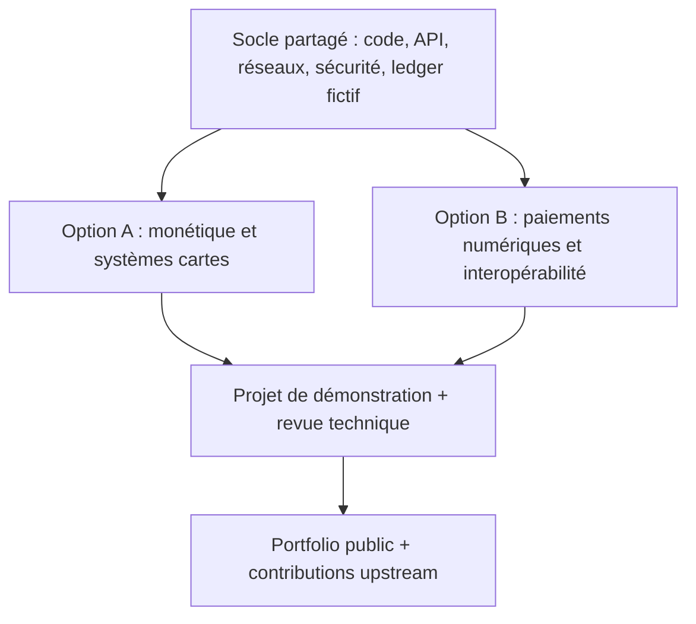

# OSEF Academy — Parcours communautaire Ingénierie monétique & paiements

**Version : proposition publique v0.1 — 17 novembre 2026**  
**Statut : parcours de compétences à construire, sans certification ni diplôme attribué.**  
**Public :** ingénieurs logiciels, intégration, QA, DevOps/SRE, architectes et praticiens des paiements en Afrique francophone et au-delà.

> **Séparation des droits :** ce document est un **nouveau parcours OSEF**, conçu à partir des travaux **publics du dépôt** (labs OPB et architectures ARC). Il n'est pas une publication, une licence ou une transposition de la méthode, des supports, des kits et du cursus confidentiels OPPL. La possession d'un document d'évaluation OPPL ne confère pas de droit de diffusion de ses contenus. Toute coopération OPPL–OSEF exigerait un accord distinct des ayants droit.

## 1. Objectif

Permettre à un contributeur de **lire un flux de paiement, construire des composants de simulation, réaliser des intégrations contrôlées, démontrer la sécurité et observer les incidents**, puis de publier des preuves techniques vérifiables, sans jamais accéder à une infrastructure financière réelle.

Ce parcours n'est **ni un titre professionnel enregistré, ni une certification d'un scheme, ni une formation agréée**. Les durées, modalités d'évaluation et niveaux ci-dessous sont des **propositions OSEF** à piloter sur une cohorte expérimentale.

## 2. Deux itinéraires et un tronc partagé

**Option A — Monétique :** émetteur, acquéreur et switch dans un lab fictif, composition ISO 8583, reversals simulés, cas d'erreur, idempotence, sécurité des échanges et supervision.

**Option B — Paiements numériques :** API de paiement fictives, wallets, Core Banking, participants interopérables, événements, ledger/rapprochement, Open Banking et résilience.

La spécialisation est choisie **selon les preuves produites**, pas selon un intitulé de poste.

## 3. Progression proposée en quatre paliers OSEF

| Palier (sans valeur de diplôme) | Compétence observable | Preuve exigée |
|---|---|---|
| **P1 — Explorer** | Expliquer acteurs, flux, données et technologies du cas d'usage | Carte BDAT commentée et fiche sourcée |
| **P2 — Builder** | Reproduire un composant et ses scénarios nominaux/négatifs | Dépôt reproductible, commandes commentées, tests exécutés |
| **P3 — Integrator** | Définir et tester les contrats entre deux services fictifs | API/protocole versionné, idempotence et gestion des échecs |
| **P4 — Reviewer / Architect** | Argumenter architecture, risques, supervision, reprise et licences | ADR, threat model, revue indépendante et démonstration |

**Aucun palier n'est aujourd'hui une certification OSEF officiellement établie**. Les critères restent à valider en pilote.

## 4. Parcours de compétences lié aux architectures et aux labs publics

| Domaine OSEF | Compétences et questions d'ingénierie | Architecture | Labs / issues d'entrée |
|---|---|---|---|
| **Fondations paiement** | Acteurs, états de transaction, cohérence, flux, architecture et provenance logicielle | [ARC-10](../architecture/blueprints/ARC-10.md) | OPB-001, OPB-018 |
| **Core Banking** | Comptes fictifs, prêts, écriture et données métier | [ARC-01](../architecture/blueprints/ARC-01.md) | OPB-002, OPB-003, OPB-004 |
| **ISO 8583 & cartes** | Structure des messages, tests d'encodage/décodage, refus et erreurs | [ARC-02](../architecture/blueprints/ARC-02.md) | [OPB-D03-001](../../labs/03-card-payments/OPB-D03-001/START-HERE.md) ; issue #41 |
| **Interopérabilité** | Participants, états incertains, doublons, rejets et contrats d'API | [ARC-03](../architecture/blueprints/ARC-03.md) | OPB-005, OPB-006, OPB-007, OPB-008 |
| **Wallet** | Ordre fictif, solde, transaction et idempotence | [ARC-04](../architecture/blueprints/ARC-04.md) | Lab dédié à proposer |
| **Open Banking** | Scopes, autorisation, API et flux de consentement simulés | [ARC-05](../architecture/blueprints/ARC-05.md) | OPB-009, OPB-010 |
| **Ledger et rapprochement** | Doubles écritures, écarts, correspondances et audit | [ARC-06](../architecture/blueprints/ARC-06.md) | OPB-015 ; lab ledger dédié à proposer |
| **Paiement marchand** | Orchestration, statuts, callbacks, retries et erreurs | [ARC-07](../architecture/blueprints/ARC-07.md) | OPB-009 ; lab gateway à proposer |
| **Fraude et sécurité** | IAM, secrets, règles d'alerte et absence de données réelles | [ARC-08](../architecture/blueprints/ARC-08.md) | OPB-010, OPB-011, OPB-012, OPB-019 |
| **Observabilité / SRE** | Corrélation, indicateurs de service, pannes et reprise | [ARC-09](../architecture/blueprints/ARC-09.md) | OPB-014, OPB-016, OPB-017 |
| **Industrialisation QA** | Contrats, CI, jeux de tests, rapports de preuve | [ARC-10](../architecture/blueprints/ARC-10.md) | OPB-018, OPB-020, OPB-D03-001 |

**Note :** ces liens constituent des **correspondances pédagogiques proposées**. Une issue existante ou un blueprint BDAT ne prouve pas un lab terminé ni l'acquisition de la compétence.

## 5. Projets de validation par spécialité

### Projet A — ISO 8583 Test Bench (100 % fictif)
Objectif : un programme encode/décode des messages ISO 8583 **entièrement synthétiques**, un hôte fictif envoie réponse ou refus, puis un test produit une trame tronquée.

**Livrables :** schéma de données, tests automatisés réellement exécutés, rapport négatif, logs expurgés, README d'installation, avis sur licence et limites. Point de départ : [OPB-D03-001](../../labs/03-card-payments/OPB-D03-001/START-HERE.md). **Ce prototype n'a pas de réussite de tests confirmée.**

### Projet B — Transfer API Simulator (100 % fictif)
Objectif : deux institutions mockées échangent un ordre fictif ; le système distingue **refus**, **timeout**, **doublon** et **état inconnu** sans déduire un échec d'un simple silence réseau.

**Livrables :** contrats, machine à états, scénario de test injectant une panne, tableau de bord, rapport d'écart et procédures de reprise. Point de départ : OPB-007 et [ARC-03](../architecture/blueprints/ARC-03.md).

### Projet C — Financial Reliability Case Study
Objectif : simuler une API de paiement et vérifier comportement en cas de panne contrôlée.

**Livrables :** métriques, traces, tests de rejets/reprises, analyse de sécurité et runbook. Point de départ : OPB-016/017/018 et [ARC-09](../architecture/blueprints/ARC-09.md).

**Aucun projet final n'autorise de connexion à un switch, banque, scheme de cartes, API de paiement de production ou données de clients.**

## 6. Modalités et évaluation proposées

- **Format :** autonome + revues de pairs + éventuels ateliers communautaires, soumis aux disponibilités réelles.
- **Durée :** flexible, sans volume horaire garanti ; définir et mesurer sur une première cohorte OSEF avant toute annonce d'équivalence.
- **Évaluation :** revue du code, succès et échec des tests documentés, conformité aux contrats du lab, sécurité, qualité des logs et explication des choix.
- **Évaluation du portfolio :** lien vers issue/PR, date, versions, résultat et rôle exact du contributeur.
- **Validation :** chaque palier ne pourra être attribué qu'après une procédure de gouvernance et de revue explicitement établie ; aucune attestation automatique.

### Definition of Done — évaluation d'un lab
- [ ] Description du cas et diagramme BDAT annoté.
- [ ] Versions/licences/provenance des dépendances vérifiées.
- [ ] Réseau isolé et données financières entièrement fictives.
- [ ] Installation documentée, scripts et commandes commentés.
- [ ] Succès + rejets + timeouts/doublons si pertinents.
- [ ] Logs, tests, limites et résultats réellement observés.
- [ ] Relecture indépendante (ou absence signalée explicitement).
- [ ] PR et issue reliées, sans promesse de certification ni de production.

## 7. Contribution upstream et communauté

Une contribution à OSEF n'est pas une contribution acceptée par les projets amont. Pour les outils concernés, lire et respecter les fichiers CONTRIBUTING, licences, CLA/DCO et règles de sécurité du projet d'origine.

- [Guide de contribution OSEF](../../CONTRIBUTING.md)
- [Rejoindre OSEF](../../JOIN-US.md)
- [Code de conduite](../../CODE_OF_CONDUCT.md)
- [Sécurité](../../SECURITY.md)
- [Catalogue des 20 premiers labs](../../labs/README.md)
- [Architectures cibles](../architecture/blueprints/README.md)

## 8. Gouvernance et propriété intellectuelle

**Public OSEF :** travaux originaux ou légalement réutilisables, sources officielles, exemples synthétiques, blueprints et tests du dépôt, sous réserve de vérification des licences.

**Privé et hors du dépôt :** curriculum, méthodes pédagogiques, kits et supports OPPL marqués confidentiels ; aucune reproduction ou redistribution sans autorisation écrite du titulaire des droits.

**Pas de confusion des marques :** OSEF Academy n'est pas une certification OPPL, ni une qualification reconnue par un régulateur ou une université. Tout accord de licence, partenariat ou co-formation doit être explicite et documenté.

## 9. Proposition de lancement (non validée)

1. Recruter volontairement des relecteurs pour OPB-001, OPB-D03-001 et les blueprints ARC-02/ARC-10.
2. Vérifier les instructions et exécuter les tests du prototype ISO 8583 ; publier **les résultats réellement observés**, même s'ils échouent.
3. Construire un jeu de scénarios synthétiques de référence réutilisable.
4. Organiser une démonstration communautaire **seulement après** validation des résultats et disponibilité des intervenants.
5. Faire un bilan du pilote et décider des éventuels niveaux OSEF, responsables et attestations.

---

*English summary:* This is a proposed, community-maintained, non-accredited OSEF Payment & Card Engineering pathway. It maps public OSEF labs and BDAT blueprints to observable competencies and synthetic-data projects. It neither publishes nor licenses confidential OPPL teaching materials. No production payment rails, banking customer data or recognized certification are involved.
