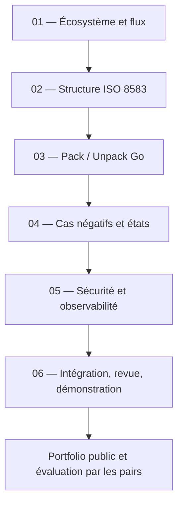

# OSEF Academy — Parcours Ingénieur monétique & ISO 8583

**Version 0.1 — 17 novembre 2026 · Proposition communautaire, non diplômante, non certifiante**

**Périmètre :** six fiches pédagogiques **originales OSEF** construites à partir des blueprints et des labs publics du dépôt. Ce parcours n'est pas une publication du curriculum, des méthodes, du matériel ou des supports OPPL marqués confidentiels. Aucun résultat de lab n'est réputé réussi sans preuve.

**Prérequis commun recommandé :** [Tronc commun OSEF — 7 fiches](../tronc-commun/README.md). Les acquis doivent être démontrés ; aucun diplôme n'est présumé.

## Parcours de progression

| Ordre | Fiche | Niveau cible | Livrable vérifiable |
|---|---|---|---|
| 01 | [Acteurs, responsabilités et cycle d'un paiement carte](01-ECOSYSTEME-ET-FLUX.md) | P1 Explorer | Diagramme source Mermaid, glossaire de 12 termes minimum et note de limites. |
| 02 | [MTI, bitmap, champs et spécification de message](02-STRUCTURE-MESSAGE-ISO8583.md) | P1 Explorer | Table de spécification pédagogique annotée et schéma expliquant le bitmap. |
| 03 | [Encoder, décoder et vérifier un message fictif en Go](03-PACK-UNPACK-GO.md) | P2 Builder | go.mod / go.sum après validation, code commenté, preuve de go test, trace d'exécution avec version de Go. |
| 04 | [Rejets, erreurs de format, doublons et états incertains](04-CAS-NEGATIFS-ET-ETATS.md) | P2 Builder / P3 Integrator | Matrice de tests (entrée, attendu, observé, statut), diagramme de machine à états. |
| 05 | [Sécurité des messages, journalisation et observabilité](05-SECURITE-ET-OBSERVABILITE.md) | P3 Integrator | Threat model, checklist sécurité, spécification des logs et des métriques. |
| 06 | [Contrat de simulation, démonstration et contribution amont](06-INTEGRATION-ET-REVUE.md) | P3 Integrator / P4 Reviewer | README de démo, diagramme, scripts commentés, résultats de tests, lien PR et revue. |

## Pré-requis et fonctionnement
- Débutants : lecture technique, GitHub, bases de programmation recommandées.
- Réalisation : dépôt ou fork local, travaux par petites PR reliées aux issues.
- Outillage : Git et Go pour la fiche 03, outils de dessin de diagrammes pour la fiche 01.
- Démonstrations : **données fictives exclusivement**, pas de carte, PAN, PIN, CVV, données clients, secrets ou réseau bancaire.
- Volume horaire : **à mesurer lors d'un pilote** ; pas de durée garantie ni de reconnaissance automatique des niveaux.

## Grille d'évaluation
Consulter la [grille et le dossier de preuves](EVALUATION.md), puis [OPB-D03-001 — point de départ du code](../../../labs/03-card-payments/OPB-D03-001/START-HERE.md) et [ARC-02 — architecture cible](../../architecture/blueprints/ARC-02.md).

**Important :** le prototype public Go n'a pas encore de compilation ni de tests confirmés. La première tâche technique consiste à le vérifier, consigner les éventuels échecs et corriger dans une PR.

## Validation et transparence
Une fiche est **documentée** dès qu'elle existe dans le dépôt. Elle n'est **réalisée** que si un apprenant publie la preuve demandée, et **revue** seulement après un retour indépendant. Aucune désignation d'évaluateur, cohorte, badge ou certification n'est déclarée ici.

[Retour au parcours général](../PARCOURS-INGENIEUR-MONETIQUE-PAIEMENT-OSEF.md) · [Contribuer](../../../CONTRIBUTING.md) · [Sécurité](../../../SECURITY.md)

**EN summary:** Public, non-accredited, six-step card-payments and ISO 8583 learning path, based on OSEF's own public labs. All exercises use synthetic data, and no real banking systems are contacted.
