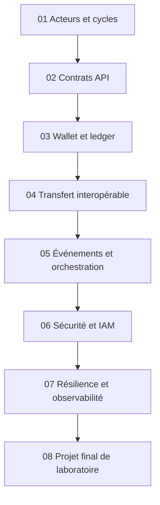

# OSEF Academy — Ingénierie des paiements numériques et de l'interopérabilité

**Parcours public proposé v0.1 — 17 novembre 2026.** **Non diplômant, non certifiant, non déployé en cohorte à ce jour.** Ce cursus est une création pédagogique OSEF fondée sur les labs et blueprints **publics** du dépôt. Il ne reproduit pas les kits, méthodes ou supports des documents OPPL confidentiels.

**Prérequis commun recommandé :** [Tronc commun OSEF — 7 fiches](../tronc-commun/README.md). Les acquis doivent être démontrés ; aucun diplôme n'est présumé.

## Mission de l'ingénieur de paiement numérique

Concevoir, implémenter, tester et faire exploiter **en laboratoire** les composants qui permettent à plusieurs systèmes hétérogènes d'échanger des instructions et états de paiement : API, adaptateurs, wallets fictifs, événements, mécanismes de cohérence, sécurité et observabilité.

**Ce que nous n'affirmons pas :** aucune connexion au système PI-SPI, aucune accréditation BCEAO ou conformité PCI DSS, aucun service financier, aucun paiement réel, aucune homologation ni certification professionnelle.

## Séquence proposée

| Étape | Fiche pédagogique | Palier | Blueprint(s) |
|---|---|---|---|
| 1 | [Acteurs et cycle de vie](01-ACTEURS-ET-CYCLE.md) | P1 Explorer | ARC-03 |
| 2 | [API de paiement fictive](02-API-PAIEMENT.md) | P2 Builder | ARC-05 |
| 3 | [Wallet, ledger, rapprochement](03-WALLET-ET-LEDGER.md) | P2 Builder | ARC-04 / ARC-06 |
| 4 | [Transfert interopérable fictif](04-INTEROPERABILITE.md) | P3 Integrator | ARC-03 |
| 5 | [Orchestration et événements](05-EVENEMENTS-ET-ORCHESTRATION.md) | P3 Integrator | ARC-07 / ARC-10 |
| 6 | [Sécurité, IAM et fraude simulée](06-SECURITE.md) | P3 Integrator | ARC-05 / ARC-08 |
| 7 | [Observabilité et résilience](07-RESILIENCE.md) | P3 Integrator | ARC-09 |
| 8 | [Projet final et revue d'architecture](08-CAPSTONE.md) | P4 Reviewer / Architect | ARC-03 / ARC-10 |

## Choisir un projet concret

### Projet PNI-A — API de paiement synthétique
**Modules 01–02 + 06 :** définir un contrat OpenAPI, mocker les acteurs, faire échouer proprement une requête non autorisée et une requête dupliquée. Issue de départ : [OPB-009](https://github.com/opensource-enterprise-factory/osef-open-source-payment-banking-labs/issues/9).

### Projet PNI-B — Deux participants fictifs interopérables
**Modules 03–05 :** simuler deux institutions, un journal de transactions, un adaptateur et un traitement de réponse tardive. Blueprint : [ARC-03](../../architecture/blueprints/ARC-03.md) ; issues de départ : [OPB-005 à OPB-008](../../../labs/README.md).

### Projet PNI-C — Résilience d'un flux de paiement fictif
**Modules 06–07 :** instrumenter un flux, provoquer un timeout, établir la corrélation et documenter les règles d'escalade et de résolution sans supposer qu'un timeout signifie un rejet. Blueprint : [ARC-09](../../architecture/blueprints/ARC-09.md).

### Capstone
**Module 08 :** plateforme simulée de bout en bout : **application fictive → API → orchestrateur → participants simulés → ledger → observabilité**. Présentation d'un scénario nominal et d'erreurs. **Tous les transferts et écritures sont fictifs.**

## Admission et prérequis proposés

- Bases de programmation, Git, tests, HTTP/JSON et notions réseau.
- Pour les profils débutants : commencer par [OPB-001](../../../labs/01-foundations/OPB-001/README.md) et le [catalogue de labs](../../../labs/README.md).
- Compétences ciblées : développeur paiements, intégrateur API, ingénieur interopérabilité, ingénieur QA/SRE spécialisé.
- Temps de formation : **non fixé** ; à mesurer et décider à l'issue d'un pilote, sans prétendre à une équivalence universitaire.

## Règles de progression

1. Choisir une fiche et ouvrir ou rejoindre une issue adaptée.
2. Produire les livrables demandés avec données synthétiques.
3. Consigner versions, commandes commentées et résultats réellement observés.
4. Demander une revue et documenter honnêtement ce qui n'a pas fonctionné.
5. Construire un portfolio de PR, tests et diagrammes, sans prétendre qu'un palier implique une certification.

[Grille d'évaluation](EVALUATION.md) · [Parcours général](../PARCOURS-INGENIEUR-MONETIQUE-PAIEMENT-OSEF.md) · [Sécurité](../../../SECURITY.md) · [Contribuer](../../../CONTRIBUTING.md)

## Architecture liée

- [ARC-03 — Hub d'interopérabilité](../../architecture/blueprints/ARC-03.md)
- [ARC-04 — Wallet](../../architecture/blueprints/ARC-04.md)
- [ARC-05 — Open Banking API](../../architecture/blueprints/ARC-05.md)
- [ARC-06 — Ledger et rapprochement](../../architecture/blueprints/ARC-06.md)
- [ARC-07 — Passerelle marchande](../../architecture/blueprints/ARC-07.md)
- [ARC-08 — Sécurité](../../architecture/blueprints/ARC-08.md)
- [ARC-09 — Observabilité](../../architecture/blueprints/ARC-09.md)
- [ARC-10 — Fabrique de tests](../../architecture/blueprints/ARC-10.md)

## Propriété intellectuelle

Cette documentation est un contenu original OSEF conçu pour la contribution au dépôt. Les documents privés OPPL fournis à titre d'évaluation ne sont ni copiés, ni publiés, ni implicitement licenciés à OSEF. Les autres technologies référencées sont soumises aux licences de leurs projets amont.

---

**English summary:** A proposed non-accredited, eight-unit, community-driven digital payments and interoperability engineering pathway. It uses OSEF public labs/blueprints and synthetic financial data only. No live payment connections, guaranteed training delivery, or compliance certification.
