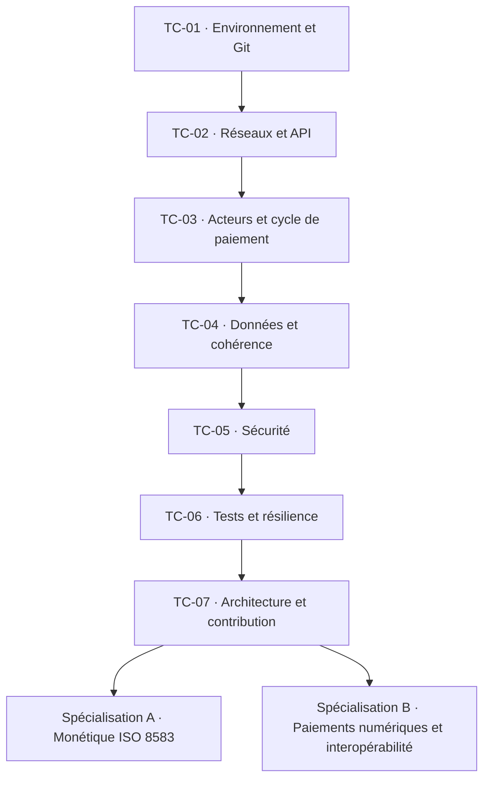

# OSEF Academy — Tronc commun Ingénierie des paiements

**Proposition pédagogique publique v0.1 — 17 novembre 2026.** Sept modules **conçus pour l'OSEF**, distincts des programmes et supports confidentiels OPPL. Non diplômant, non certifiant, non encore validé par une cohorte.

## Objectif du socle

Avant de choisir une spécialité, chaque ingénieur développe les mêmes fondations : **ingénierie logicielle, langage des paiements, interfaces, données transactionnelles, sécurité, qualité, résilience et architecture Open Source**.

L'ordre est **recommandé**, mais pas une dépendance technique absolue. Les durées et le niveau d'entrée seront mesurés à l'occasion d'un pilote ; pas de volume horaire officiel annoncé.

## Modules et réalisations

| Code | Module | Livrable de sortie | Labs / architectures associés |
|---|---|---|---|
| TC-01 | [Environnement, Git et reproductibilité](TC-01-SYSTEMES-ET-GIT.md) | README, commandes commentées, contribution | OPB-001, OPB-018 ; ARC-10 |
| TC-02 | [Réseaux, API et contrats](TC-02-RESEAUX-API-ET-CONTRATS.md) | Contrat d'API fictive et tests | OPB-009 ; ARC-05/10 |
| TC-03 | [Acteurs et cycle de paiement](TC-03-METIERS-ET-CYCLE-PAIEMENT.md) | Diagramme séquentiel/BDAT + lexique | OPB-001, OPB-005 ; ARC-01/02/03 |
| TC-04 | [Données, ledger et idempotence](TC-04-DONNEES-ET-COHERENCE.md) | Écritures synthétiques + contrôle d'invariants | OPB-015 ; ARC-06 |
| TC-05 | [Identités, secrets et sécurité](TC-05-SECURITE-ET-CONFIANCE.md) | Threat model + tests d'autorisation | OPB-010/011/019 ; ARC-05/08 |
| TC-06 | [Qualité, incidents et résilience](TC-06-QUALITE-ET-RESILIENCE.md) | Matrice de tests et rapport de panne | OPB-016/017/018 ; ARC-09/10 |
| TC-07 | [Architecture BDAT et contribution Open Source](TC-07-ARCHITECTURE-ET-OPEN-SOURCE.md) | BDAT, ADR et PR documentée | OPB-001/020 ; ARC-10 |

**Statut réel :** seules les fiches de formation sont publiées. Le tableau ne signifie pas que les labs correspondants sont exécutés ou que les acquis d'un candidat ont été évalués.

## Épreuve de synthèse du tronc commun (proposée)

**Cas :** deux services fictifs (« client de paiement » et « API de paiement ») échangent un ordre à montant fictif sans mouvement de fonds.

1. Documenter le processus et les acteurs dans un BDAT.
2. Spécifier le contrat REST, les identifiants, l'idempotence et les erreurs.
3. Créer un journal fictif et une règle de contrôle des doublons.
4. Définir une frontière de confiance et un contrôle d'accès.
5. Tester un succès, un rejet, un doublon et un timeout fictifs.
6. Fournir des traces expurgées, une note de reprise et une PR.

**Ce projet ne requiert pas de fournisseur de paiement, de réseau réel ni de technologie imposée.** Il peut être réalisé avec un mock local et un langage choisi par le contributeur. La mise en œuvre n'est **pas fournie** par ce document : elle doit être construite, testée et revue.

## Règles de passage vers les spécialisations

Le passage n'est pas basé sur un certificat, une durée ou un titre. Il repose sur un **portfolio technique vérifiable** et la grille [EVALUATION.md](EVALUATION.md), sous réserve de validation de la gouvernance OSEF.

- [Parcours A — Monétique et ISO 8583](../monetique-iso8583/README.md)
- [Parcours B — Paiements numériques et interopérabilité](../paiements-numeriques-interoperabilite/README.md)
- [Catalogue de labs](../../../labs/README.md)
- [Guide de contribution](../../../CONTRIBUTING.md)
- [Sécurité](../../../SECURITY.md)

## Limites et propriété intellectuelle

Ce tronc commun est un référentiel **original de la communauté OSEF**, inspiré de besoins d'ingénierie généraux et des labs/architectures publics de ce dépôt. Il ne distribue aucun kit, cours, script, méthode ou syllabus réservé des documents OPPL confidentiels.

Les technologies citées dans les blueprints restent candidates : **aucune homologation BCEAO, certification PCI DSS, interopérabilité réelle ou capacité de production n'est revendiquée**.

**English summary:** Seven proposed public core modules before the two OSEF payment engineering specializations. Evidence, synthetic data, versioned contracts and independent review are essential; no accredited certificate or production banking deployment is implied.
