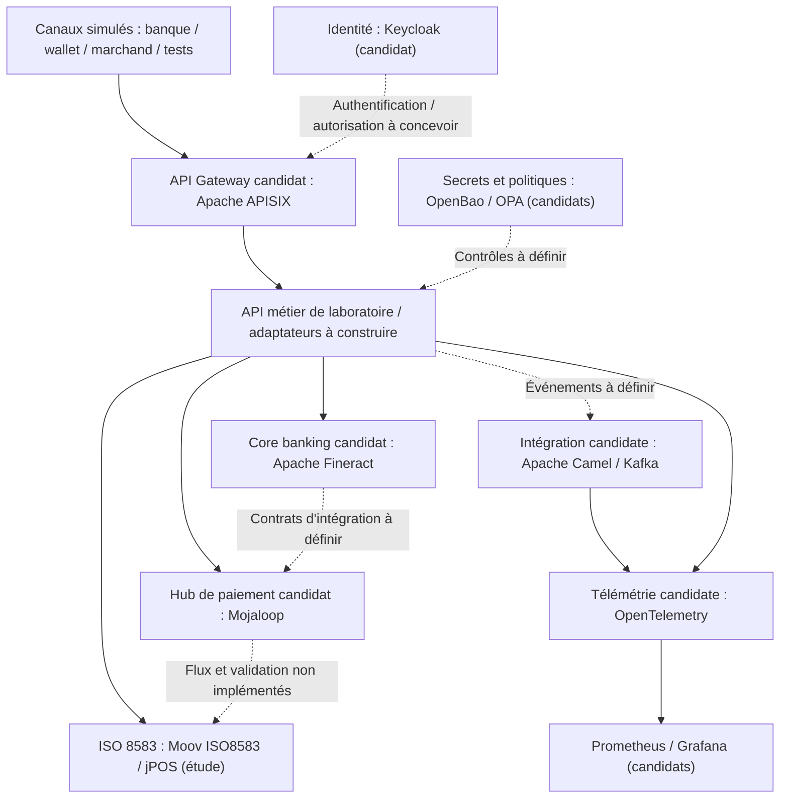

# OSEF Open Source Payment & Banking Labs — Architecture de référence

> **Statut : architecture conceptuelle proposée, version 1.0 — 16 novembre 2026.**  
> **Aucune intégration bout en bout, conformité bancaire, certification PCI DSS ou compatibilité avec PI-SPI n'est démontrée à ce stade.** Tous les composants ci-dessous sont **candidats** ; le choix définitif doit être validé par les labs et des revues de sécurité/licences.

## Catalogue des architectures par cas d'usage

Le [catalogue des dix blueprints](blueprints/README.md) permet de choisir une architecture en fonction du besoin métier, plutôt que de déployer toutes les briques simultanément. Chaque blueprint propose composants, interfaces, scénarios de test, risques, labs associés et critères de validation. Voir le [modèle commun](blueprints/BLUEPRINT-TEMPLATE.md).

**Priorité proposée :** ARC-10 (Testing Factory), ARC-02 (ISO 8583), ARC-09 (Observabilité), ARC-01 (Core Banking), ARC-03 (Interopérabilité). Toutes les architectures sont au stade **proposé** : ni intégration prouvée ni homologation de production.

## 1. Objectif et périmètre

Fournir une vision partagée des briques techniques et des interfaces à étudier pour former des ingénieurs, développer des simulateurs réutilisables et réaliser des **démonstrations isolées**, uniquement à l'aide de données fictives.

Ce dépôt n'est **ni un switch opérationnel, ni une banque, ni un prestataire de paiement**, et ne doit pas accéder à des comptes, cartes, données ou réseaux financiers réels.

## 2. Vue d'ensemble (conceptuelle)

**Lecture :** les flèches indiquent des **relations pédagogiques envisagées**, et non des connecteurs existants ou testés. Aucune compatibilité fonctionnelle entre Fineract, Mojaloop et la monétique ISO 8583 ne doit être déduite de ce schéma.

## 3. Couches de l'architecture

| Couche | Responsabilité conceptuelle | Technologies à étudier | Critère à démontrer |
|---|---|---|---|
| Canaux et participants | Simuler client, établissement, wallet, marchand | Simulateurs OSEF à développer | Données strictement synthétiques |
| Exposition API | Routage, politiques, erreurs, observabilité des API | Apache APISIX | Tests d'API et de contrôles d'accès |
| Identité et secrets | Identités, permissions, secrets et politiques | Keycloak, OpenBao, OPA | Aucun secret en dépôt, contrôles testés |
| Core banking | Comptes, prêts et opérations bancaires simulées | Apache Fineract | Installation et API vérifiées dans OPB-002 |
| Paiements interopérables | Flux interparticipants et cycle de transaction | Mojaloop | Contrats et simulation vérifiés dans OPB-005–008 |
| Monétique | Composition, encodage et décodage de messages ISO 8583 | Moov ISO8583, jPOS (licences distinctes) | Pack/Unpack testé dans OPB-D03-001 |
| Intégration / événements | Adaptation, échanges, publication de messages | Apache Camel, Kafka | Idempotence, erreurs et reprise testées |
| Observabilité | Métriques, traces et alertes | OpenTelemetry, Prometheus, Grafana | Corrélation et scénarios de panne démontrés |
| Infrastructure | Exécution reproductible des labs | Docker ou Kubernetes, à décider par lab | Recréation sur environnement neuf |

## 4. Parcours à démontrer — sans flux financiers réels

### Scénario A — Compte bancaire fictif
1. Un acteur synthétique appelle une API de laboratoire.
2. Le service vérifie les permissions sur des identités de test.
3. Apache Fineract, **une fois déployé et validé**, exécute une opération fictive.
4. Le lab capture les résultats et erreurs sans données personnelles.

**Preuve attendue :** OPB-002 / OPB-003, avec tests documentés.

### Scénario B — Paiement interopérable fictif
1. Deux participants entièrement fictifs sont modélisés.
2. Les contrats d'API et le cycle des messages sont documentés.
3. Des tests nominaux et dégradés simulent états, timeouts et rejets.
4. Aucun transfert réel, compensation ou règlement n'est effectué.

**Preuve attendue :** OPB-005 à OPB-008, une fois implémentés.

### Scénario C — Message monétique fictif
1. Un programme local produit un message de démonstration ISO 8583.
2. Il teste encodage/décodage, puis rejets et troncatures.
3. Il vérifie les champs sans PAN, PIN, CVV ou donnée réelle.
4. Aucune connexion à TPE, HSM, émetteur, acquéreur ou switch.

**Preuve attendue :** [OPB-D03-001](../../labs/03-card-payments/OPB-D03-001/START-HERE.md). Code initial présent, **tests non confirmés**.

## 5. Interfaces et contrats à spécifier

| Interface envisagée | Contrat minimal à documenter | Statut |
|---|---|---|
| Canal → Gateway / API | URL, méthode, schéma, auth, codes d'erreur, limites | À définir |
| API → Fineract | API et version ciblées, mapping des comptes fictifs | Non validé |
| API → Mojaloop | Participant, requêtes, statuts et erreurs | Non validé |
| API → composant ISO 8583 | MTI, bitmap, champs, version de spécification | Prototype local, non exécuté |
| API / services → Kafka | Schéma d'événements, corrélation, idempotence et rejeu | À définir |
| Services → observabilité | Métriques, traces, logs expurgés, rétention | À définir |

**Principes :** pas de couplage caché, tests de contrat avant intégration, échecs explicites, mécanismes de reprise et gestion des doublons documentés.

## 6. Sécurité, gouvernance et conformité

- **Lab isolé** : pas de réseau bancaire, paiement réel, compte de production ou données clients.
- **Données synthétiques** uniquement ; aucun PAN, PIN, piste magnétique, CVV ou secret d'infrastructure réel.
- **Contrôles** : identité, moindre privilège, secrets hors Git, TLS adapté au contexte, journalisation expurgée, gestion des vulnérabilités.
- **Conformité** : licence Open Source ≠ sécurité ni conformité réglementaire. Toute évaluation BCEAO/UEMOA, PCI DSS ou contractuelle requiert une analyse spécifique.
- **Licences** : examiner chaque dépôt/version ; jPOS et Moov ISO8583 ne présentent pas les mêmes obligations de licence.
- **Exploitation** : aucune promesse de disponibilité, montée en charge ou reprise avant tests.
- **Contribution** : respecter les règles et licences des projets upstream et séparer données confidentielles et contributions publiques.

## 7. Environnements et déploiement

- **Niveau 1 — poste développeur** : code local, tests unitaires et composants minimaux.
- **Niveau 2 — lab multi-services isolé** : API, IAM, faux participants, observabilité, tests contractuels.
- **Niveau 3 — lab d'intégration avancé** : composants bancaires et de paiement, cas dégradés, tests de charge et reprise, sous revue sécurité.

**Aucun dimensionnement VM, cluster Kubernetes, SLA ou scénario de production n'est validé par ce document.** Les besoins en CPU, mémoire, stockage, ports, versions et réseau doivent être établis et mesurés lab par lab.

## 8. État actuel et liens de pilotage

| Chantier | État confirmé dans le dépôt |
|---|---|
| [OPB-001 — cartographie de l'écosystème](../../labs/01-foundations/OPB-001/README.md) | Cadrage et documentation en cours |
| [OPB-D03-001 — ISO 8583](../../labs/03-card-payments/OPB-D03-001/START-HERE.md) | Code prototype présent, compilation/tests non confirmés |
| [Catalogue général des labs](../../labs/README.md) | Vingt labs initiaux documentés au niveau catalogue |
| [Stratégie 2027–2029](../strategy/OSEF-PAYMENT-ENGINEERING-ROADMAP-2027-2029.md) | Proposition stratégique, non validée formellement |
| [Produits et services](../strategy/OSEF-PAYMENT-ENGINEERING-PRODUCTS-SERVICES.md) | Catalogue commercial proposé |

Issues de suivi : [OPB-001 #1](https://github.com/opensource-enterprise-factory/osef-open-source-payment-banking-labs/issues/1), [OPB-D03-001 #41](https://github.com/opensource-enterprise-factory/osef-open-source-payment-banking-labs/issues/41), [OPB-002 #2](https://github.com/opensource-enterprise-factory/osef-open-source-payment-banking-labs/issues/2), [OPB-005 #5](https://github.com/opensource-enterprise-factory/osef-open-source-payment-banking-labs/issues/5).

## 9. Critères de passage d'architecture « proposée » à « validée »

- [ ] Diagramme relu par au moins deux ingénieurs ;
- [ ] Versions et licences des composants figées ;
- [ ] Environnements reproductibles et consignes d'isolation ;
- [ ] Contrats d'API et scénarios normal / erreur documentés ;
- [ ] Exécution attestée par résultats de tests et logs expurgés ;
- [ ] Tests de résilience et contrôles de sécurité adaptés au périmètre ;
- [ ] Décisions techniques et limites connues consignées.

## 10. Références officielles
- [Apache Fineract](https://fineract.apache.org/)
- [Mojaloop](https://docs.mojaloop.io/)
- [Moov ISO8583](https://github.com/moov-io/iso8583)
- [Apache APISIX](https://apisix.apache.org/)
- [Keycloak](https://www.keycloak.org/)
- [Apache Camel](https://camel.apache.org/)
- [Apache Kafka](https://kafka.apache.org/)
- [OpenTelemetry](https://opentelemetry.io/)
- [Open Source Definition — OSI](https://opensource.org/osd)

---

**English summary:** This is a conceptual lab reference architecture for open-source banking and payment engineering. Components, integrations and arrows are proposals only. No production financial transactions, sensitive card data, regulatory compliance or end-to-end interoperability are claimed. Evidence from reproducible labs is required before any component or integration is marked validated.
