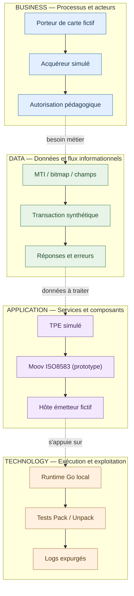

# ARC-02 — Vue BDAT : Card Payment & ISO 8583

> **Architecture cible proposée / non validée en laboratoire.** Diagramme conceptuel modifiable : aucun raccordement, support de production, conformité PCI DSS ou homologation BCEAO/PI-SPI n'est revendiqué.

## Diagramme BDAT

## Lecture par couche

| Couche | Éléments principaux | Question d'architecture |
|---|---|---|
| **Business** | Porteur de carte fictif · Acquéreur simulé · Autorisation pédagogique | Quel processus et quels acteurs sont servis ? |
| **Data** | MTI / bitmap / champs · Transaction synthétique · Réponses et erreurs | Quelles données fictives et quelles garanties de cohérence ? |
| **Application** | TPE simulé · Moov ISO8583 (prototype) · Hôte émetteur fictif | Quelles fonctions et interfaces sont nécessaires ? |
| **Technology** | Runtime Go local · Tests Pack / Unpack · Logs expurgés | Où et comment exploiter/tester le service ? |

Les flèches entre couches indiquent la **traçabilité des préoccupations**, pas des appels techniques réellement implémentés. Les flèches internes sont des relations simplifiées pour le cadrage. Les composants candidats ne sont pas présumés intégrés.

## À vérifier avant validation
- [ ] Acteurs et processus Business revus par un praticien du domaine.
- [ ] Modèle Data et données de lab purement synthétiques définis.
- [ ] Contrats, versions et licences des composants Application vérifiés.
- [ ] Dimensionnement, sécurité, isolation, supervision Technology documentés.
- [ ] Scénarios nominal, rejet, timeout, reprise et doublon adaptés au cas d'usage.
- [ ] Revue indépendante avec preuves de tests anonymisées.

[Blueprint détaillé](./ARC-02.md) · [Catalogue BDAT](./BDAT-README.md) · [Architecture OSEF](../README.md)

## English summary
Four-layer Business/Data/Application/Technology conceptual view for Card Payment & ISO 8583. All components and relationships require implementation, testing, licensing review and independent validation.
