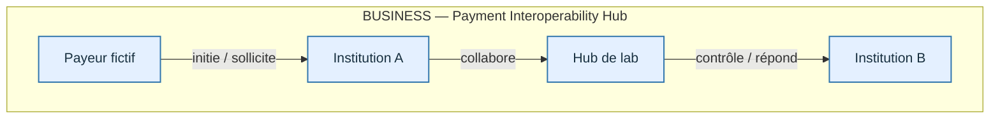

# ARC-03-B — Vue Business · Payment Interoperability Hub

**Version 0.1 · 17 novembre 2026 · Statut : proposé, non validé en laboratoire**  
**Objectif de cette couche :** rendre visibles les acteurs, décisions et parcours métier de la simulation.

> **Diagramme pédagogique et conceptuel** fondé sur le [blueprint ARC-03](ARC-03.md). Les flèches décrivent des relations **proposées**, pas une preuve d'intégration. Tous les acteurs, données, environnements et transferts sont fictifs. La conformité, les performances et la production ne sont pas démontrées.

## 1. Visuel Business — Mermaid modifiable

## 2. Descriptif de la vue

Cette vue traduit le cas d'usage en interactions et responsabilités métier. Elle sert à valider les exigences auprès des experts du domaine, avant tout choix d'outil.

**Éléments de la couche :**
- **Payeur fictif** — élément 1 à préciser dans une revue Business.
- **Institution A** — élément 2 à préciser dans une revue Business.
- **Hub de lab** — élément 3 à préciser dans une revue Business.
- **Institution B** — élément 4 à préciser dans une revue Business.

**Cas / informations à documenter pour ARC-03 :**
- Initiation du transfert
- Vérification participante
- Transmission et réponse
- Résolution incertitude

## 3. Prérequis
- Comprendre le cas d'usage et les acteurs financiers fictifs.
- Différencier initiation, autorisation, traitement, compensation et règlement lorsqu'ils s'appliquent.
- Lire la vue d'ensemble et identifier les limites du lab.

## 4. Exigences détaillées
- [ ] **ARC-03-B-01 :** Identifier les acteurs et leurs rôles / responsabilités.
- [ ] **ARC-03-B-02 :** Décrire le parcours nominal et les événements métier alternatifs.
- [ ] **ARC-03-B-03 :** Formaliser les critères de succès, rejets et états incertains.
- [ ] **ARC-03-B-04 :** Préciser ce qui est hors périmètre : aucune transaction financière réelle.
- [ ] **ARC-03-B-05 :** Associer chaque activité à des données, services et traces de laboratoire.

## 5. Livrables de validation
- [ ] Diagramme source révisé, périmètre, hypothèses et exclusions datés.
- [ ] Liste des acteurs/objets/composants/outils confrontée au besoin.
- [ ] Contrats, dictionnaires, tests ou mesures propres à cette couche annexés.
- [ ] Revue indépendante et statut réel consignés, avec liens vers les preuves.
- [ ] Aucun secret ou donnée bancaire réelle dans les fichiers.

## 6. Risques et limites

- **Spécification** : le diagramme simplifie le domaine ; les règles et interfaces exactes restent à établir.
- **Sécurité** : pas de PAN, PIN, CVV, compte client, clé HSM, identifiant ou infrastructure financière réels.
- **Maturité** : « proposé » n'est ni « testé », ni « validé en laboratoire », ni « homologué ».
- **Licences / réglementation** : chaque composant et activité doit être évalué pour sa version, sa licence et ses obligations applicables.

## 7. Articulation des vues et labs

**Navigation :** [Business](ARC-03-B.md) · [Data](ARC-03-D.md) · [Application](ARC-03-A.md) · [Technology](ARC-03-T.md) · [BDAT synthèse](ARC-03-BDAT.md) · [Blueprint](ARC-03.md)

**Labs / issues de rattachement envisagés :** OPB-005, OPB-006, OPB-007, OPB-008. Aucun test n'est présumé réussi.

[Catalogue des 40 vues](BDAT-4-VUES-README.md) · [SECURITY.md](../../../SECURITY.md)

**EN:** Proposed Business layer view for Payment Interoperability Hub. Synthetic data, non-production scope, no assumed integration or certification.
