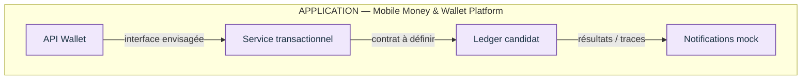

# ARC-04-A — Vue Application · Mobile Money & Wallet Platform

**Version 0.1 · 17 novembre 2026 · Statut : proposé, non validé en laboratoire**  
**Objectif de cette couche :** décrire les services applicatifs et leurs frontières contractuelles.

> **Diagramme pédagogique et conceptuel** fondé sur le [blueprint ARC-04](ARC-04.md). Les flèches décrivent des relations **proposées**, pas une preuve d'intégration. Tous les acteurs, données, environnements et transferts sont fictifs. La conformité, les performances et la production ne sont pas démontrées.

## 1. Visuel Application — Mermaid modifiable

## 2. Descriptif de la vue

Cette vue distingue les services de laboratoire des produits candidats. Les appels doivent encore être spécifiés dans des contrats et démontrés dans des tests reproductibles.

**Éléments de la couche :**
- **API Wallet** — élément 1 à préciser dans une revue Application.
- **Service transactionnel** — élément 2 à préciser dans une revue Application.
- **Ledger candidat** — élément 3 à préciser dans une revue Application.
- **Notifications mock** — élément 4 à préciser dans une revue Application.

**Cas / informations à documenter pour ARC-04 :**
- Client ↔ API : ordres fictifs
- API ↔ service : validation
- Service ↔ ledger : écriture cohérente

## 3. Prérequis
- Comprendre les API, adaptateurs, mocks et contrats d'interface.
- Connaître les erreurs, rejets, timeouts, réessais et idempotence.
- Lire un diagramme de composants et de séquence.

## 4. Exigences détaillées
- [ ] **ARC-04-A-01 :** Décrire les responsabilités, interfaces, entrées et sorties de chaque composant.
- [ ] **ARC-04-A-02 :** Définir et versionner API, schémas, messages et erreurs.
- [ ] **ARC-04-A-03 :** Tracer les séquences nominales, refus, timeout, reprise et double requête.
- [ ] **ARC-04-A-04 :** Documenter authentification, autorisation et appels entre domaines de confiance.
- [ ] **ARC-04-A-05 :** Préciser quels composants sont mockés, candidats ou réellement construits.

## 5. Livrables de validation
- [ ] Diagramme source révisé, périmètre, hypothèses et exclusions datés.
- [ ] Liste des acteurs/objets/composants/outils confrontée au besoin.
- [ ] Contrats, dictionnaires, tests ou mesures propres à cette couche annexés.
- [ ] Revue indépendante et statut réel consignés, avec liens vers les preuves.
- [ ] Aucun secret ou donnée bancaire réelle dans les fichiers.

## 6. Risques et limites

- **Spécification** : le diagramme simplifie le domaine ; les règles et interfaces exactes restent à établir.
- **Sécurité** : pas de PAN, PIN, CVV, compte client, clé HSM, identifiant ou infrastructure financière réels.
- **Maturité** : « proposé » n'est ni « testé », ni « validé en laboratoire », ni « homologué ».
- **Licences / réglementation** : chaque composant et activité doit être évalué pour sa version, sa licence et ses obligations applicables.

## 7. Articulation des vues et labs

**Navigation :** [Business](ARC-04-B.md) · [Data](ARC-04-D.md) · [Application](ARC-04-A.md) · [Technology](ARC-04-T.md) · [BDAT synthèse](ARC-04-BDAT.md) · [Blueprint](ARC-04.md)

**Labs / issues de rattachement envisagés :** Lab wallet dédié à créer. Aucun test n'est présumé réussi.

[Catalogue des 40 vues](BDAT-4-VUES-README.md) · [SECURITY.md](../../../SECURITY.md)

**EN:** Proposed Application layer view for Mobile Money & Wallet Platform. Synthetic data, non-production scope, no assumed integration or certification.
