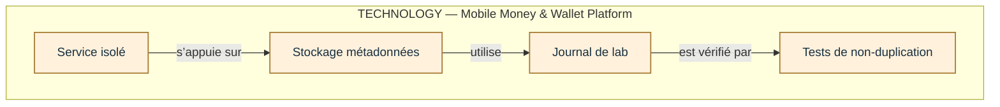

# ARC-04-T — Vue Technology · Mobile Money & Wallet Platform

**Version 0.1 · 17 novembre 2026 · Statut : proposé, non validé en laboratoire**  
**Objectif de cette couche :** décrire les supports techniques et les conditions d'exploitation du lab.

> **Diagramme pédagogique et conceptuel** fondé sur le [blueprint ARC-04](ARC-04.md). Les flèches décrivent des relations **proposées**, pas une preuve d'intégration. Tous les acteurs, données, environnements et transferts sont fictifs. La conformité, les performances et la production ne sont pas démontrées.

## 1. Visuel Technology — Mermaid modifiable

## 2. Descriptif de la vue

Cette vue représente des fonctions d'infrastructure et d'exploitation. Les outils cités sont des options de cadrage ; ni leurs versions, ni leurs ressources, ni leurs intégrations ne sont considérées validées.

**Éléments de la couche :**
- **Service isolé** — élément 1 à préciser dans une revue Technology.
- **Stockage métadonnées** — élément 2 à préciser dans une revue Technology.
- **Journal de lab** — élément 3 à préciser dans une revue Technology.
- **Tests de non-duplication** — élément 4 à préciser dans une revue Technology.

**Cas / informations à documenter pour ARC-04 :**
- TigerBeetle à évaluer
- IAM non choisi

## 3. Prérequis
- Savoir distinguer runtime, stockage, réseau et exploitation.
- Avoir les bases de conteneurisation, IAM, secrets et tests automatisés.
- Connaître les contraintes de licences des logiciels Open Source.

## 4. Exigences détaillées
- [ ] **ARC-04-T-01 :** Indiquer l'environnement d'exécution, le stockage, le réseau et le niveau d'isolation.
- [ ] **ARC-04-T-02 :** Consigner les versions exactes et licences vérifiées, sans supposer de compatibilité.
- [ ] **ARC-04-T-03 :** Définir secrets de test, accès, logging, instrumentation et sauvegarde.
- [ ] **ARC-04-T-04 :** Préciser ressources CPU/RAM/stockage et ports uniquement après mesure.
- [ ] **ARC-04-T-05 :** Prévoir installation, nettoyage, scripts commentés, tests CI et preuve de reprise.

## 5. Livrables de validation
- [ ] Diagramme source révisé, périmètre, hypothèses et exclusions datés.
- [ ] Liste des acteurs/objets/composants/outils confrontée au besoin.
- [ ] Contrats, dictionnaires, tests ou mesures propres à cette couche annexés.
- [ ] Revue indépendante et statut réel consignés, avec liens vers les preuves.
- [ ] Aucun secret ou donnée bancaire réelle dans les fichiers.

## 6. Risques et limites

- **Spécification** : le diagramme simplifie le domaine ; les règles et interfaces exactes restent à établir.
- **Sécurité** : pas de PAN, PIN, CVV, compte client, clé HSM, identifiant ou infrastructure financière réels.
- **Maturité** : « proposé » n'est ni « testé », ni « validé en laboratoire », ni « homologué ».
- **Licences / réglementation** : chaque composant et activité doit être évalué pour sa version, sa licence et ses obligations applicables.

## 7. Articulation des vues et labs

**Navigation :** [Business](ARC-04-B.md) · [Data](ARC-04-D.md) · [Application](ARC-04-A.md) · [Technology](ARC-04-T.md) · [BDAT synthèse](ARC-04-BDAT.md) · [Blueprint](ARC-04.md)

**Labs / issues de rattachement envisagés :** Lab wallet dédié à créer. Aucun test n'est présumé réussi.

[Catalogue des 40 vues](BDAT-4-VUES-README.md) · [SECURITY.md](../../../SECURITY.md)

**EN:** Proposed Technology layer view for Mobile Money & Wallet Platform. Synthetic data, non-production scope, no assumed integration or certification.
