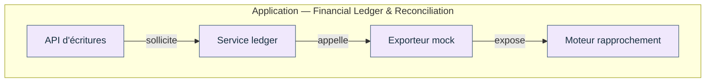

# ARC-06-A — Application · Financial Ledger & Reconciliation

**Version 0.1 — 17 novembre 2026 · Vue proposée, non validée en laboratoire.**

> La vue est conceptuelle et se fonde sur le [blueprint ARC-06](ARC-06.md). Aucun paiement, banque, compte, secret ou réseau réel. Aucune homologation ni compatibilité intégrée démontrée.

## 1. Diagramme Mermaid modifiable

## 2. Descriptif
La vue applicative décrit des responsabilités et des contrats envisagés, sans présumer de la compatibilité ou de la mise en œuvre réelle des composants.

**Éléments de la couche :**
- **API d'écritures** : rôle et comportement exacts à confirmer.
- **Service ledger** : rôle et comportement exacts à confirmer.
- **Exporteur mock** : rôle et comportement exacts à confirmer.
- **Moteur rapprochement** : rôle et comportement exacts à confirmer.

**Aspects spécifiques à cette architecture :**
- API ↔ journal : contrat d'écriture
- Journal ↔ export : référence
- Export ↔ recon : comparaison

## 3. Prérequis
- Lecture des schémas d'architecture applicative.
- API, contrats, messages, idempotence et erreurs.
- Principes d'authentification et d'intégration.

## 4. Exigences détaillées
- [ ] **ARC-06-A-01 :** Définir les responsabilités de chaque application et son API.
- [ ] **ARC-06-A-02 :** Versionner les contrats d'interface et formats d'erreur.
- [ ] **ARC-06-A-03 :** Documenter succès, échec, timeout, retry et réexécution.
- [ ] **ARC-06-A-04 :** Préciser IAM, secrets de lab et frontière de confiance.
- [ ] **ARC-06-A-05 :** Distinguer les mocks, composants candidats et composants testés.

## 5. Preuves attendues
- [ ] Acteurs, objets, interfaces ou composants explicités dans un registre.
- [ ] Diagramme relu par un praticien concerné ; décisions et hypothèses tracées.
- [ ] Contrat, dictionnaire, cas de test ou mesures adaptés à la couche.
- [ ] Versions et licences vérifiées lorsqu'un composant externe est cité.
- [ ] Résultat observé distinct du résultat attendu ; absence de test signalée.
- [ ] Aucune donnée sensible réelle, fichiers et logs expurgés.

## 6. Risques, statut, traçabilité
- Les liens du diagramme sont des **relations proposées** et ne démontrent pas l'existence de connecteurs.
- Un timeout ne signifie pas systématiquement une opération rejetée.
- Aucun contrôle de sécurité, métrique de production ou conformité réglementaire ne peut être déduit de cette fiche.
- **Labs/études liés :** OPB-015 ; état de validation à vérifier dans les issues.

## 7. Navigation
[Business](ARC-06-B.md) · [Data](ARC-06-D.md) · [Application](ARC-06-A.md) · [Technology](ARC-06-T.md) · [Synthèse BDAT](ARC-06-BDAT.md) · [Blueprint complet](ARC-06.md) · [Atlas](BDAT-4-VUES-README.md)

**English summary:** Proposed standalone Application view of Financial Ledger & Reconciliation, documented for offline, synthetic labs only; independent review and tests are pending.
