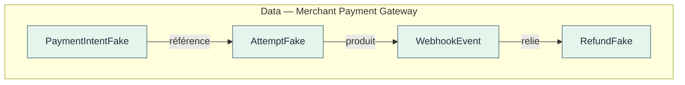

# ARC-07-D — Data · Merchant Payment Gateway

**Version 0.1 — 17 novembre 2026 · Vue proposée, non validée en laboratoire.**

> La vue est conceptuelle et se fonde sur le [blueprint ARC-07](ARC-07.md). Aucun paiement, banque, compte, secret ou réseau réel. Aucune homologation ni compatibilité intégrée démontrée.

## 1. Diagramme Mermaid modifiable

## 2. Descriptif
La vue de données identifie les informations et dépendances conceptuelles ; elle n'est pas un schéma physique ni une preuve de cohérence transactionnelle.

**Éléments de la couche :**
- **PaymentIntentFake** : rôle et comportement exacts à confirmer.
- **AttemptFake** : rôle et comportement exacts à confirmer.
- **WebhookEvent** : rôle et comportement exacts à confirmer.
- **RefundFake** : rôle et comportement exacts à confirmer.

**Aspects spécifiques à cette architecture :**
- intent_id
- provider_ref
- idempotency_key
- webhook_event_id

## 3. Prérequis
- Bases de modèle de données et d'identifiants.
- Notions d'intégrité transactionnelle et d'audit.
- Connaissance des données synthétiques et de leur cycle de vie.

## 4. Exigences détaillées
- [ ] **ARC-07-D-01 :** Décrire chaque objet avec type, identifiant et source fictive.
- [ ] **ARC-07-D-02 :** Définir les relations, contraintes et règles de validité.
- [ ] **ARC-07-D-03 :** Documenter les changements d'état, la déduplication et l'idempotence.
- [ ] **ARC-07-D-04 :** Prévoir journal, conservation et purge des données de laboratoire.
- [ ] **ARC-07-D-05 :** Appliquer minimisation, classification et expurgation des traces.

## 5. Preuves attendues
- [ ] Acteurs, objets, interfaces ou composants explicités dans un registre.
- [ ] Diagramme relu par un praticien concerné ; décisions et hypothèses tracées.
- [ ] Contrat, dictionnaire, cas de test ou mesures adaptés à la couche.
- [ ] Versions et licences vérifiées lorsqu'un composant externe est cité.
- [ ] Résultat observé distinct du résultat attendu ; absence de test signalée.
- [ ] Aucune donnée sensible réelle, fichiers et logs expurgés.

## 6. Risques, statut, traçabilité
- Les liens du diagramme sont des **relations proposées** et ne démontrent pas l'existence de connecteurs.
- Un timeout ne signifie pas systématiquement une opération rejetée.
- Aucun contrôle de sécurité, métrique de production ou conformité réglementaire ne peut être déduit de cette fiche.
- **Labs/études liés :** OPB-009 ; état de validation à vérifier dans les issues.

## 7. Navigation
[Business](ARC-07-B.md) · [Data](ARC-07-D.md) · [Application](ARC-07-A.md) · [Technology](ARC-07-T.md) · [Synthèse BDAT](ARC-07-BDAT.md) · [Blueprint complet](ARC-07.md) · [Atlas](BDAT-4-VUES-README.md)

**English summary:** Proposed standalone Data view of Merchant Payment Gateway, documented for offline, synthetic labs only; independent review and tests are pending.
