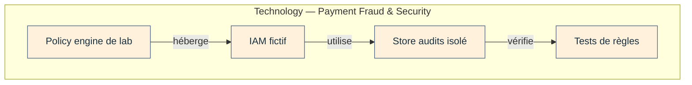

# ARC-08-T — Technology · Payment Fraud & Security

**Version 0.1 — 17 novembre 2026 · Vue proposée, non validée en laboratoire.**

> La vue est conceptuelle et se fonde sur le [blueprint ARC-08](ARC-08.md). Aucun paiement, banque, compte, secret ou réseau réel. Aucune homologation ni compatibilité intégrée démontrée.

## 1. Diagramme Mermaid modifiable

## 2. Descriptif
La vue technique liste des capacités d'hébergement et d'exploitation envisageables, et non une configuration de production dimensionnée.

**Éléments de la couche :**
- **Policy engine de lab** : rôle et comportement exacts à confirmer.
- **IAM fictif** : rôle et comportement exacts à confirmer.
- **Store audits isolé** : rôle et comportement exacts à confirmer.
- **Tests de règles** : rôle et comportement exacts à confirmer.

**Aspects spécifiques à cette architecture :**
- OPA/Keycloak candidats
- Pas de dispositif AML certifié

## 3. Prérequis
- Linux, réseaux et environnements isolés.
- Bases DevOps, secrets, déploiement et monitoring.
- Connaissance de la traçabilité des versions et licences.

## 4. Exigences détaillées
- [ ] **ARC-08-T-01 :** Nommer runtime, isolation, stockage, réseau et dépendances.
- [ ] **ARC-08-T-02 :** Consigner versions, sources et licences avant intégration.
- [ ] **ARC-08-T-03 :** Définir comptes techniques et secrets éphémères hors Git.
- [ ] **ARC-08-T-04 :** Préciser ressources/ports uniquement après mesures effectives.
- [ ] **ARC-08-T-05 :** Décrire automatisation, observabilité, backup, nettoyage et reprise.

## 5. Preuves attendues
- [ ] Acteurs, objets, interfaces ou composants explicités dans un registre.
- [ ] Diagramme relu par un praticien concerné ; décisions et hypothèses tracées.
- [ ] Contrat, dictionnaire, cas de test ou mesures adaptés à la couche.
- [ ] Versions et licences vérifiées lorsqu'un composant externe est cité.
- [ ] Résultat observé distinct du résultat attendu ; absence de test signalée.
- [ ] Aucune donnée sensible réelle, fichiers et logs expurgés.

## 6. Risques, statut, traçabilité
- Les liens du diagramme sont des **relations proposées** et ne démontrent pas l'existence de connecteurs.
- Un timeout ne signifie pas systématiquement une opération rejetée.
- Aucun contrôle de sécurité, métrique de production ou conformité réglementaire ne peut être déduit de cette fiche.
- **Labs/études liés :** OPB-010, OPB-011, OPB-012 ; état de validation à vérifier dans les issues.

## 7. Navigation
[Business](ARC-08-B.md) · [Data](ARC-08-D.md) · [Application](ARC-08-A.md) · [Technology](ARC-08-T.md) · [Synthèse BDAT](ARC-08-BDAT.md) · [Blueprint complet](ARC-08.md) · [Atlas](BDAT-4-VUES-README.md)

**English summary:** Proposed standalone Technology view of Payment Fraud & Security, documented for offline, synthetic labs only; independent review and tests are pending.
