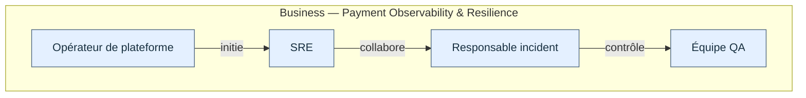

# ARC-09-B — Business · Payment Observability & Resilience

**Version 0.1 — 17 novembre 2026 · Vue proposée, non validée en laboratoire.**

> La vue est conceptuelle et se fonde sur le [blueprint ARC-09](ARC-09.md). Aucun paiement, banque, compte, secret ou réseau réel. Aucune homologation ni compatibilité intégrée démontrée.

## 1. Diagramme Mermaid modifiable

## 2. Descriptif
La vue métier montre qui réalise les activités du cas fictif, ce qui est attendu et comment les exceptions sont traitées. Les flèches sont indicatives, pas des workflows approuvés.

**Éléments de la couche :**
- **Opérateur de plateforme** : rôle et comportement exacts à confirmer.
- **SRE** : rôle et comportement exacts à confirmer.
- **Responsable incident** : rôle et comportement exacts à confirmer.
- **Équipe QA** : rôle et comportement exacts à confirmer.

**Aspects spécifiques à cette architecture :**
- Surveiller indicateurs
- Détecter panne fictive
- Diagnostiquer
- Restaurer et documenter

## 3. Prérequis
- Notions des rôles bancaires ou de paiement concernés.
- Compréhension d'un processus, ses acteurs et exceptions.
- Lecture de la description du cas d'usage.

## 4. Exigences détaillées
- [ ] **ARC-09-B-01 :** Attribuer explicitement les rôles et droits des acteurs fictifs.
- [ ] **ARC-09-B-02 :** Décrire le scénario métier nominal et les exceptions.
- [ ] **ARC-09-B-03 :** Distinguer acceptation, rejet et statut indéterminé.
- [ ] **ARC-09-B-04 :** Documenter règles métier et exclusions (pas de paiement réel).
- [ ] **ARC-09-B-05 :** Associer processus à événements et indicateurs observables.

## 5. Preuves attendues
- [ ] Acteurs, objets, interfaces ou composants explicités dans un registre.
- [ ] Diagramme relu par un praticien concerné ; décisions et hypothèses tracées.
- [ ] Contrat, dictionnaire, cas de test ou mesures adaptés à la couche.
- [ ] Versions et licences vérifiées lorsqu'un composant externe est cité.
- [ ] Résultat observé distinct du résultat attendu ; absence de test signalée.
- [ ] Aucune donnée sensible réelle, fichiers et logs expurgés.

## 6. Risques, statut, traçabilité
- Les liens du diagramme sont des **relations proposées** et ne démontrent pas l'existence de connecteurs.
- Un timeout ne signifie pas systématiquement une opération rejetée.
- Aucun contrôle de sécurité, métrique de production ou conformité réglementaire ne peut être déduit de cette fiche.
- **Labs/études liés :** OPB-016, OPB-017, OPB-018 ; état de validation à vérifier dans les issues.

## 7. Navigation
[Business](ARC-09-B.md) · [Data](ARC-09-D.md) · [Application](ARC-09-A.md) · [Technology](ARC-09-T.md) · [Synthèse BDAT](ARC-09-BDAT.md) · [Blueprint complet](ARC-09.md) · [Atlas](BDAT-4-VUES-README.md)

**English summary:** Proposed standalone Business view of Payment Observability & Resilience, documented for offline, synthetic labs only; independent review and tests are pending.
