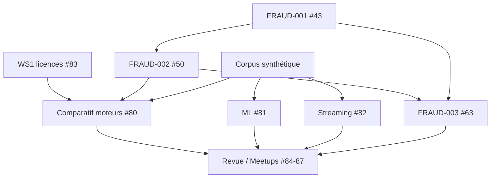

# OSFE — Backlog structuré et dépendances

**Statut initial :** issues GitHub ouvertes, non synonymes de travaux réalisés. Les propriétaires proposés sont des **rôles**, pas des personnes désignées.

## Priorités P0 à P3

| Priorité | Workstream | Travail | Dépendance | Issue | Preuve attendue |
|---|---|---|---|---|---|
| **P0** | WS1 | Inventaire licences, révisions et risques source-available | Aucune | [FRAUD-008 #83](https://github.com/opensource-enterprise-factory/osef-open-source-payment-banking-labs/issues/83) | Matrice sourcée, revue |
| **P0** | WS4 | Revalider le relais, auth, audit et tests FRAUD-001 | VM Docker/Ubuntu | [#43](https://github.com/opensource-enterprise-factory/osef-open-source-payment-banking-labs/issues/43) | Logs T01–T10 et PR |
| **P0** | WS2 | Tazama Core, mapping de sortie et tests FRAUD-002 | Ressources VM vérifiées | [#50](https://github.com/opensource-enterprise-factory/osef-open-source-payment-banking-labs/issues/50) | Santé, échantillons synthétiques, traces |
| **P1** | WS2/WS3 | Benchmark Tazama/Jube | Corpus, P0 | [#80](https://github.com/opensource-enterprise-factory/osef-open-source-payment-banking-labs/issues/80) | Rapport mesures |
| **P1** | WS2 | Évaluation ML Ojuri/Handbook | Corpus, licences | [#81](https://github.com/opensource-enterprise-factory/osef-open-source-payment-banking-labs/issues/81) | Métriques et biais |
| **P1** | WS3 | Kafka/Flink, vélocité et résilience | Schéma de données | [#82](https://github.com/opensource-enterprise-factory/osef-open-source-payment-banking-labs/issues/82) | Test fenêtre/reprise |
| **P2** | WS4/WS5 | Interopérabilité fédérée et investigation | #43, #50 validés | [#63](https://github.com/opensource-enterprise-factory/osef-open-source-payment-banking-labs/issues/63) | Matrice rôles, cas et audit |
| **P2** | WS6 | Meetups techniques de partage des preuves | Lab réellement exécuté | [#84–87](https://github.com/opensource-enterprise-factory/osef-open-source-payment-banking-labs/issues?q=is%3Aissue+is%3Aopen+%5BMEETUP%5D) | Support + démo ou limite explicitée |
| **P3** | WS6 | Contribution upstream ciblée | PR testée et lue | À créer après identification d'une issue upstream | Issue/PR effective |

## Relations entre les travaux

## Politique de tickets et PR

- Nommer les nouvelles issues **[OSFE][WSx]**, sauf labs déjà identifiés FRAUD-xxx.
- Chaque issue doit comporter objectif, source, licence, prérequis, implémentation, tests, preuve, risques, licence d'exploitation et condition de clôture.
- Aucun accès root direct au serveur ou modification manuelle d'une VM de référence : décrire les configurations comme code et les soumettre en PR.
- Réutiliser les tickets existants ; ne pas réaffecter FRAUD-004.
- Statuts recommandés : `proposé`, `en cours`, `en revue`, `validé avec preuves`, `bloqué`, sans prétendre qu'ils sont tous des labels créés dans GitHub.
- Suivi hebdomadaire : une note en issue de pilotage avec 3 priorités, risques et liens de PR ; ne pas déclarer une action comme achevée sans preuve.

## Besoins de décision

- [ ] Nommer un responsable de programme volontaire et un suppléant
- [ ] Identifier des référents WS1–WS6 avec disponibilité réaliste
- [ ] Confirmer le matériel disponible pour les deux moteurs
- [ ] Valider le périmètre des données synthétiques et le protocole de benchmark
- [ ] Fixer les critères de sélection d'un premier pilote uniquement pédagogique
- [ ] Valider un calendrier de meetups après démonstration
