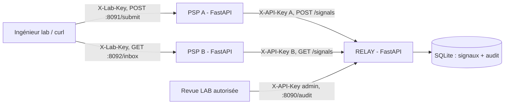

# OSEF FRAUD-001 — Lab d'interopérabilité antifraude entre PSP fictifs

> **Statut : prototype pédagogique proposé.** Les fichiers de démarrage sont publiés mais les tests Docker n'ont pas été exécutés sur une machine de référence par OSEF. À faire valider par un ingénieur avant publication d'un résultat. **Ce projet n'est pas une implémentation officielle de l'Open Financial Trust Alliance (OFTA), ni une plateforme de détection de fraude de production.**

- [Issue de pilotage #43](https://github.com/opensource-enterprise-factory/osef-open-source-payment-banking-labs/issues/43)
- [Fiche de veille OFTA](../../docs/veille/2026-11-18/OFTA-FRAUD-INTEROPERABILITY.md)
- [Meetup associé #46](https://github.com/opensource-enterprise-factory/osef-open-source-payment-banking-labs/issues/46)


## Exécution sur laptop Windows avec VirtualBox

Pour une VM Ubuntu Server 24.04 LTS unique avec les trois conteneurs Docker, voir le [guide VirtualBox + Ubuntu détaillé](VIRTUALBOX-UBUNTU.md). Il couvre la configuration de la VM, l'installation officielle de Docker, les commandes, les tests, la sécurité réseau et le dépannage. **Ce parcours n'est pas encore validé par un test matériel confirmé.**

## 1. Objectif et limites

Simuler le partage **d'un signal de risque non nominatif** d'un PSP A vers un PSP B à travers un service relais commun. Prouver par des tests qu'un échange autorisé fonctionne, qu'un doublon est refusé, qu'un acteur non autorisé ne peut pas lire le relais et qu'un audit minimal existe.

**Interdictions :** aucune donnée client, PAN/carte bancaire, MSISDN, identifiant réel de compte ou de transaction, IP de production, secret réel, passerelle de paiement, accès réseau bancaire, donnée de fraude réelle. Les identifiants de transactions doivent commencer par `demo-`. Ne pas exposer les services sur Internet. Pas de conformité PCI DSS, AML/KYC ou RGPD revendiquée.

## 2. Architecture de référence



**Flux fonctionnel :**
1. L'ingénieur crée une alerte fictive via PSP A.
2. PSP A valide le JSON via Pydantic et contacte le relais avec son identité propre.
3. Le relais authentifie PSP A, vérifie le schéma, inscrit le signal et un événement d'audit dans SQLite.
4. PSP B s'authentifie auprès du relais et lit uniquement les signaux non expirés qui lui sont destinés.
5. L'ingénieur vérifie l'audit avec une clé admin distincte. Le relais interdit l'accès anonyme et n'autorise pas PSP A à consulter l'inbox de PSP B.
6. Le TTL est appliqué **à la lecture** : les alertes expirées restent physiquement dans SQLite. La purge physique est une amélioration obligatoire avant tout usage autre que cette démo.

## 3. Technologies open source retenues

| Couche | Choix | Justification | Limite |
|---|---|---|---|
| Environnement | Docker Engine + Compose v2 | Reproductibilité locale, isolation des trois services | Pas une architecture haute disponibilité |
| API PSP A / PSP B / relais | Python 3.12 + FastAPI + Uvicorn | API HTTP simple, OpenAPI auto-documenté | Pas de mTLS, ni service mesh |
| Schémas | Pydantic v2 | Typage strict des catégories et champs autorisés | Pas un standard OFTA |
| Appels internes | HTTPX | Client HTTP asynchrone | Trafic HTTP sur réseau Docker de lab |
| Persistance | SQLite | Démonstrateur minimal, aucun serveur DB séparé | Pas conçu pour transactions multi-nœuds |
| Audit | Table SQLite dédiée | Piste élémentaire acteur/action/résultat | Non immuable, logs non exhaustifs |
| Tests | Bash + curl + Python | Scénarios observables et accessibles aux ingénieurs | Ensemble de tests de base, à étendre |

**Choix délibéré :** pas de Kafka, Kubernetes, Keycloak, PostgreSQL ou moteur antifraude complexe pour ce premier lab. Ces briques deviennent pertinentes en phase 2, après validation des flux minimaux. Le moteur **Tazama** peut faire l'objet d'un lab distinct ; il n'est **pas** intégré ici.

Références des projets :
- FastAPI : https://fastapi.tiangolo.com/
- Pydantic : https://docs.pydantic.dev/
- Docker Compose : https://docs.docker.com/compose/
- HTTPX : https://www.python-httpx.org/
- SQLite : https://sqlite.org/
- OWASP API Security Top 10 : https://owasp.org/API-Security/

## 4. Prérequis de la machine

- Linux Ubuntu récent, ou Windows 11 + WSL2 Ubuntu avec Docker opérationnel.
- Docker Engine + plugin `docker compose` ; `git`, `bash`, `openssl`, `curl`, `python3`.
- **Ressources recommandées (dimensionnement de lab, non testé) :** 2 vCPU, 4 Gio RAM libres, 2 Gio de disque ; aucun GPU.
- Ports libres : **8090** (relais/admin), **8091** (PSP A), **8092** (PSP B), tous liés à `127.0.0.1`.
- Accès Internet pour installer les images et dépendances. Version des paquets Python actuellement bornée par versions majeures, pas figée au niveau patch : figer les versions et scanner les images avant les prochains sprints.

### Vérification

```bash
docker --version                # Le moteur Docker est-il installé ?
docker compose version         # Vérifie Compose v2.
docker info >/dev/null         # Vérifie l'accès au démon, sans sudo implicite.
git --version
openssl version
curl --version
python3 --version
```

**Attention :** si l'utilisateur n'a pas accès à Docker, faire régler les permissions par l'administrateur de la machine ; l'accès au socket Docker accorde des privilèges élevés.

## 5. Procédure de réalisation — pas à pas

### Étape A — récupérer le code

```bash
git clone https://github.com/opensource-enterprise-factory/osef-open-source-payment-banking-labs.git
cd osef-open-source-payment-banking-labs/labs/FRAUD-001

# Vérifier la liste des fichiers de l'expérience.
ls -la
```

Pour une installation déjà clonée, `git pull --ff-only` depuis une branche propre puis naviguer vers le dossier.

### Étape B — générer les secrets de lab

```bash
# Génère quatre clés aléatoires locales dans .env si absent ; n'écrase jamais un .env existant.
bash scripts/init-env.sh

# Valide la syntaxe du fichier Compose et la présence des variables.
docker compose config --quiet
```

Ne jamais copier le contenu du `.env` dans une issue, un support de meetup ou un chat public. **Ne pas committer ce fichier.** Pour renouveler les secrets : arrêter les conteneurs, sauvegarder/supprimer le `.env` puis relancer l'initialisation ; cela invalide les anciennes clés, sans constituer une révocation fine par PSP.

### Étape C — construire, démarrer et contrôler

```bash
# Reconstruit localement les trois images et démarre les conteneurs.
docker compose up --build -d

# L'état attendu est "running" et le relais "healthy".
docker compose ps

# Tous les services répondent localement.
curl --fail --silent http://127.0.0.1:8090/health
curl --fail --silent http://127.0.0.1:8091/health
curl --fail --silent http://127.0.0.1:8092/health

# Diagnostiquer un démarrage incomplet sans afficher les secrets.
docker compose logs --tail=60 relay psp-a psp-b
```

**Résultat attendu** pour chaque réponse : un JSON avec `"status":"ok"` et le rôle du conteneur.

### Étape D — exécuter les tests d'acceptation

```bash
# Vérifie le signal valide, le doublon, la clé client invalide,
# la lecture depuis PSP B, le schéma invalide et l'accès relais interdit.
bash scripts/test-lab.sh
```

**Important :** ce script est un point de départ. Les résultats doivent être réellement produits et conservés par l'ingénieur exécutant : leur succès n'a pas été vérifié ici sur Docker.

### Étape E — démonstration manuelle facultative

```bash
# Charge les variables sans afficher les valeurs des clés dans le terminal.
set -a
source .env
set +a

# Envoie un signal 100 % synthétique via PSP A, avec un jeton démo unique.
curl --fail-with-body -X POST http://127.0.0.1:8091/submit \
  -H "X-Lab-Key: $LAB_USER_KEY" \
  -H "Content-Type: application/json" \
  -d '{"transaction_token":"demo-transaction-20261118-001","category":"suspicious-transfer","severity":"high","recipient":"psp-b","expires_in_hours":1}'

# Vérifie la visibilité du signal côté PSP B (autorisé).
curl --fail-with-body http://127.0.0.1:8092/inbox \
  -H "X-Lab-Key: $LAB_USER_KEY"

# Audite les opérations depuis le relais local, avec une clé distincte.
curl --fail-with-body http://127.0.0.1:8090/audit \
  -H "X-API-Key: $ADMIN_KEY"
```

Si l'identifiant de démo a déjà été enregistré, la création répondra **409 Conflict**, conformément à la règle de dédoublonnage. Utiliser un nouveau `demo-...` pour recommencer.

### Étape F — nettoyage et réinitialisation

```bash
# Arrête les services sans supprimer la base SQLite pour inspection.
docker compose down

# ATTENTION : destructif, supprime aussi le volume SQLite et l'historique d'audit du lab.
# À exécuter seulement après avoir sauvegardé les preuves nécessaires.
docker compose down --volumes

# .env reste présent : le supprimer uniquement si les secrets doivent être renouvelés.
```

## 6. Scénarios obligatoires et résultats attendus

| Test | Entrée | Résultat attendu |
|---|---|---|
| T01 | Signal valide PSP A vers PSP B | HTTP 201 |
| T02 | Même jeton fictif soumis deux fois | HTTP 409 |
| T03 | Mauvaise clé client côté PSP A | HTTP 401 |
| T04 | Lecture via PSP B autorisé | HTTP 200 avec signal |
| T05 | Catégorie inconnue | HTTP 422 |
| T06 | Requête sans clé sur le relais | HTTP 401 |
| T07 | Consultation du journal par admin | HTTP 200 |
| T08 | Signal expiré à la lecture | N'apparaît plus dans l'inbox (test manuel/automatisation à réaliser) |
| T09 | Indisponibilité du relais | Réponse contrôlée HTTP 503 (test manuel/automatisation à réaliser) |
| T10 | Clé PSP A utilisée pour lire /signals | HTTP 401 (test manuel à réaliser) |

**Limitation :** T08–T10 ne sont pas encore inclus dans le script `test-lab.sh`. Un ingénieur doit les implémenter et publier leurs preuves avant de cocher la couverture complète.

## 7. Critères de validation et livrables de contribution

- [ ] Environnement démarré sur Linux ou WSL2, sans accès depuis l'extérieur du poste.
- [ ] T01 à T07 passent avec preuve (captures/logs expurgés).
- [ ] T08 à T10 sont exécutés, documentés et automatisés avant validation finale.
- [ ] Tous les événements et identifiants sont synthétiques.
- [ ] Documentation d'architecture, API, risques et limites réalisée.
- [ ] Diagramme des flux et séquence de traitement joints à la PR.
- [ ] Référent OSEF désigné, PR relue et environnement nettoyé.
- [ ] Aucun résultat ne prétend une conformité réglementaire ou un déploiement réel.

### Travail supplémentaire (phase 2, hors MVP)

TLS/mTLS entre services, authentification OAuth2/OIDC avec Keycloak, secrets Vault, isolation réseau renforcée, journal d'audit append-only, métriques Prometheus/Grafana, PostgreSQL, simulation de panne/résilience, gestion du consentement et des bases légales, purge TTL effective et gouvernance multi-acteurs. Étudier la compatibilité éventuelle avec un modèle public OFTA uniquement **après** publication et vérification de ses artefacts.

## 8. Dépannage

| Symptôme | Piste de diagnostic |
|---|---|
| `docker compose config` échoue | `.env` absent, lancer `bash scripts/init-env.sh` |
| Port 8090/8091/8092 occupé | Identifier le processus local, ne pas désactiver le binding loopback pour contourner |
| Relais unhealthy | `docker compose logs relay`, permissions volume SQLite |
| HTTP 401 | Utiliser la bonne clé pour l'endpoint ; ne pas publier le secret |
| HTTP 409 | Identifiant synthétique déjà soumis ; en générer un nouveau |
| HTTP 422 | Vérifier le JSON, les enums et le préfixe obligatoire `demo-` |
| HTTP 503 | Vérifier `docker compose ps`, la résolution interne `relay`, les logs |

## 9. Statut de vérification

- **Conçu / déposé :** architecture, scripts et API publiés dans le dépôt.
- **Non confirmé :** construction Docker, bon fonctionnement sur WSL2/Ubuntu, succès de bout en bout, tests T08–T10.
- **Responsable :** à désigner.
- **Contexte réglementaire :** chaque organisation doit faire sa propre analyse juridique avant tout échange réel. Le lab ne démontre aucune conformité sectorielle.

## 10. Références

- Linux Foundation, annonce de l'OFTA : https://www.linuxfoundation.org/press/linux-foundation-announces-the-open-financial-trust-alliance-to-strengthen-coordinated-protection-against-fraud-scams-and-financial-crime
- FastAPI : https://fastapi.tiangolo.com/
- Docker Compose : https://docs.docker.com/compose/
- Pydantic : https://docs.pydantic.dev/
- OWASP API Security Top 10 : https://owasp.org/API-Security/


## Démonstration dans le navigateur

Reconstruire les images depuis le dossier du lab avec `docker compose up --build -d`. Dans le navigateur de la VM, ouvrir le [relais](http://localhost:8090/), le [PSP A](http://localhost:8091/) et le [PSP B](http://localhost:8092/).

Pour ouvrir ces pages sur Windows lorsque Docker tourne dans VirtualBox, ouvrir un tunnel depuis PowerShell et laisser la session ouverte. Adapter l’adresse de la VM si nécessaire.

```powershell
ssh -N -o ExitOnForwardFailure=yes -L 127.0.0.1:8090:127.0.0.1:8090 -L 127.0.0.1:8091:127.0.0.1:8091 -L 127.0.0.1:8092:127.0.0.1:8092 lionel@192.168.255.10
```

1. Dans le PSP A, saisir `LAB_USER_KEY` du fichier `.env`, envoyer un signal (T01), puis rejouer le même jeton (T02). Les boutons T03 et T05 couvrent la clé invalide et le format invalide.
2. Dans le PSP B, saisir `LAB_USER_KEY` et copier le jeton du PSP A pour le retrouver (T04). Garder le même onglet pour T08. Après expiration réelle ou expiration forcée de ce même signal fictif dans SQLite depuis la VM, exécuter T08. Le test observe le retrait de la boîte de réception.
3. Dans le relais, tester la lecture sans clé (T06), consulter l’audit avec `ADMIN_KEY` (T07), puis tester l’interdiction de lire avec `PSP_A_KEY` (T10).
4. Pour T09, garder le PSP B ouvert, exécuter `docker compose stop relay` dans la VM, puis cliquer sur **Lire pendant l’arrêt**. Redémarrer avec `docker compose start relay`, attendre que le relais soit `healthy` et relancer la lecture.

Les champs de clés sont masqués. Les clés sont envoyées uniquement dans les en-têtes des requêtes au service affiché et ne sont pas enregistrées par l’interface. Chaque onglet affiche les statuts HTTP, le contenu JSON et l’historique local des actions.


### Accéder directement au relais depuis Windows

Depuis Ubuntu, dans le dossier du lab, indique l’IPv4 privée de la VM sur l’adaptateur Host-only VirtualBox. Pour `osef-fraud-01` :

```bash
FRAUD_HOST_ONLY_IP=192.168.255.10 docker compose -f compose.yaml -f compose.host-only.yaml up --build -d relay
curl -fsS http://192.168.255.10:8090/health
```

Ouvre [le relais](http://192.168.255.10:8090/) sur Windows. L’adresse doit déjà être attribuée à la VM. Cette option ajoute une publication du port 8090 sur l’interface privée en plus de la publication locale. Les pages PSP A et PSP B restent sur la boucle locale. Pour recréer le relais avec l’accès privé, réutilise les deux fichiers Compose et la variable. Pour revenir à l’accès local seul, exécute `docker compose up -d relay`.

Le réseau privé doit être réservé aux machines de démonstration autorisées. Utilise uniquement des données et des clés de lab.
