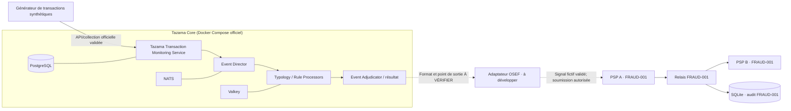

# FRAUD-002 — Détection transactionnelle avec Tazama et interopérabilité avec FRAUD-001

> **Statut : lab proposé / conception documentée ; déploiement et intégration NON testés.**
> **Usage : laboratoire isolé uniquement.** Données entièrement synthétiques, sans PSP bancaire réel.
> **Attention :** ce lab ne constitue pas une implémentation officielle de l'OFTA, ni une preuve de conformité aux réglementations sectorielles.

## 1. Pourquoi un deuxième lab ?

[FRAUD-001](../FRAUD-001/README.md) permet de **partager des signaux antifraude** entre deux PSP fictifs via un relais. Il ne réalise **aucune détection transactionnelle réelle**.

**FRAUD-002** poursuit une compétence différente :
1. Exécuter une pile **Tazama** dans un environnement de démonstration.
2. Fournir des **événements de paiement fictifs** à son pipeline de surveillance transactionnelle selon les interfaces officiellement documentées.
3. Examiner les décisions/résultats générés par la configuration de démonstration.
4. Implémenter, en phase d'intégration, un **adaptateur OSEF** qui transforme **uniquement les résultats autorisés** en signaux compatibles avec le relais FRAUD-001.
5. Prouver qu'aucune donnée sensible ne traverse le relais et qu'un PSP non autorisé ne peut accéder aux alertes.

**Important :** les alertes de Tazama et les signaux FRAUD-001 n'ont pas d'équivalence de schéma confirmée. Le mapping et le protocole restent un livrable à réaliser, pas une intégration déjà disponible.

## 2. Architecture de référence — cible, non déployée



Les flèches pointillées sont **des interfaces projetées et non implémentées**. La structure interne est une simplification pédagogique de la chaîne de traitement Tazama ; il faut confirmer les flux précis avec la version déployée.

### Frontières de confiance

- **Domaine Tazama** : événements de transactions de laboratoire et calcul de résultats de détection.
- **Adaptateur OSEF** : transforme un résultat vérifié en message de signalement minimal ; applique une allowlist de catégories et une politique de partage.
- **Domaine FRAUD-001** : transit et consultation autorisés des signaux ; pas de moteur de scoring.
- **Aucune connexion** à un PSP, banque, switch, mobile money ou registre de fraude réel.

## 3. Technologies open source et responsabilités

| Couche | Technologie | Rôle |
|---|---|---|
| Surveillance transactionnelle | **Tazama Core** | Pipeline de surveillance des événements |
| API d'entrée Tazama | **Transaction Monitoring Service (TMS)** | Point d'entrée officiel de la pile |
| Messagerie de la pile Tazama | **NATS** | Distribution asynchrone interne |
| État / configuration | **PostgreSQL** | Persistance de la stack |
| Cache | **Valkey** | Cache pour les traitements |
| Traitement | **Rule / Typology Processors** | Détection selon règles et typologies de démonstration |
| Contrôle de l'accès (optionnel) | **Keycloak** | Authentification selon configuration upstream |
| Relais de signaux | **FRAUD-001 / FastAPI** | Échange inter-PSP simulé |
| Persistance du relais | **SQLite** | Audit et signaux de FRAUD-001 |
| Adaptateur (à écrire) | **Python + HTTPX + Pydantic** | Traduction, minimisation et validation des événements |
| Déploiement local | **Docker Engine + Compose v2** | Sandbox reproductible |

La stack Tazama actuelle présente aussi les **extensions** (configuration studios, case management) et **BIAR** (analytics/reporting), mais **elles ne sont pas nécessaires pour le premier objectif de FRAUD-002**. Vérifier licences et conditions d'accès aux différents composants et images avant installation. Certains processeurs de règles peuvent avoir un accès conditionné ; ne pas les qualifier de libres d'accès sans vérification.

## 4. Matériel et environnement

### Séparer les phases

- **Phase A (FRAUD-001 seul)** : une VM Ubuntu de départ à 2 vCPU / 4 Gio RAM peut servir d'essai, sans garantie de performances.
- **Phase B (Tazama Core)** : la pile officielle comprend plusieurs composants et peut demander bien plus de RAM/CPU/disque. **Aucun minimum matériel fiable pour une VM VirtualBox n'est confirmé dans cette fiche**. Ne pas présenter la VM FRAUD-001 de 4 Gio comme suffisante.
- **Phase C (cohabitation FRAUD-001 + Tazama)** : vérifier les **ports** et ressources, ainsi que les réseaux, avant tout lancement simultané. Utiliser une VM distincte pour Tazama si la VM initiale est insuffisante.

**Pré-requis communs :** Ubuntu récent, Docker/Compose, Git, curl, accès Internet, espace pour images Docker et volumes. Un compte GitHub/jeton `read:packages` peut être requis selon les images choisies dans la stack officielle ; garder le jeton hors des dépôts. Ne pas exposer les ports de la stack à Internet.

## 5. Procédure détaillée — Phase A : vérifier FRAUD-001

Lire [le guide VirtualBox + Ubuntu](../FRAUD-001/VIRTUALBOX-UBUNTU.md). Dans la VM :

```bash
# Récupérer les labs OSEF.
git clone https://github.com/opensource-enterprise-factory/osef-open-source-payment-banking-labs.git
cd osef-open-source-payment-banking-labs/labs/FRAUD-001

# Préparer les secrets non versionnés et contrôler la syntaxe Compose.
bash scripts/init-env.sh
sudo docker compose config --quiet

# Démarrer FRAUD-001, puis exécuter les scénarios de base.
sudo docker compose up --build -d
bash scripts/test-lab.sh

# Arrêter pour libérer les ressources avant Tazama.
sudo docker compose down
```

**Gate A :** conserver preuves T01–T07 ; ne pas poursuivre si l'authentification ou la séparation des rôles ne fonctionne pas.

## 6. Procédure détaillée — Phase B : installer Tazama Core

**Source officielle actuelle :**
- [tazama-lf/tazama-stack](https://github.com/tazama-lf/tazama-stack)
- [README Core](https://github.com/tazama-lf/tazama-stack/blob/main/core/README.md)

La stack officielle est destinée à la **démonstration, exploration et test**, et non à la production.

```bash
# Sur la VM dédiée au lab Tazama : vérifier les ressources réellement disponibles.
free -h
df -h /
sudo docker version
sudo docker compose version

# Cloner la branche principale officielle de la stack.
git clone --branch main https://github.com/tazama-lf/tazama-stack.git
cd tazama-stack

# Enregistrer le commit exact pour garantir une reproduction ultérieure.
git rev-parse HEAD

# Consulter la documentation Core correspondant à ce commit.
less core/README.md

# Vérifier le script de lancement Linux avant exécution.
ls -l core/tazama-core.sh
```

**Important :** lire les options du script `core/tazama-core.sh` et la documentation associée **avant** de lancer le déploiement, car les options et prérequis peuvent évoluer. Dans les sources actuelles, l'option de déploiement public basée sur les images DockerHub est présentée comme un démarrage rapide ; vérifier la disponibilité des images sélectionnées et les éventuelles exigences d'authentification. Le fichier officiel peut nécessiter des clés ou variables d'environnement particulières.

```bash
# Seulement après lecture du script et du README officiel :
cd core
bash ./tazama-core.sh

# Contrôle de santé prévu par la documentation upstream lorsque la pile est démarrée :
curl --fail-with-body http://127.0.0.1:5000/
```

**Attendu selon upstream :** réponse JSON indiquant un service disponible (exemple officiel `{"status":"UP"}`). **Le succès et les ports effectifs sont à vérifier avec la version sélectionnée**.

Documenter :
- Version/commit Tazama, Docker/Compose, VM, RAM libre, stockage.
- Choix exact du menu et des images, état des conteneurs, ports exposés.
- Détails expurgés des secrets.
- Capture du contrôle de santé et logs sans identifiant sensible.

**Gate B :** Tazama Core sain et test officiel réussi. Ne pas poursuivre l'intégration si le déploiement de base échoue.

## 7. Phase C : comprendre le format transactionnel de Tazama

Le schéma du message **ne doit pas être inventé** à partir des champs de FRAUD-001. Utiliser les collections de test / exemples upstream **pour le commit choisi** :

1. Localiser les collections Postman et fichiers d'environnement cités dans `core/README.md`.
2. Inspecter le contrat exact de l'API du TMS, les types d'événements et l'authentification.
3. Utiliser le jeu de données **synthétique** fourni par le projet ou un jeu de test conforme.
4. Exécuter **un** scénario nominal et **un** scénario provoquant la règle de démonstration.
5. Collecter la réponse API et la sortie réellement observée (event adjudicator, message, API, autre canal documenté).
6. Produire un tableau `champ émis / signification / confidentialité / destination / rétention`.

**Gate C :** preuve de traitement de transactions synthétiques par la pile ; identification vérifiée du résultat exploitable par un futur adaptateur.

## 8. Phase D : spécifier puis développer l'adaptateur OSEF

Ne pas supposer qu'il existe déjà un webhook directement exploitable, ni accéder aux bases internes Tazama par requêtes improvisées.

### Contrat cible minimal — spécification OSEF

```json
{
  "transaction_token": "demo-transaction-001",
  "category": "suspicious-transfer",
  "severity": "high",
  "recipient": "psp-b",
  "expires_in_hours": 1
}
```

Il s'agit du **schéma d'entrée de FRAUD-001**, **pas d'un schéma officiel Tazama/OFTA**.

L'adaptateur devra :
- Lire un **résultat Tazama confirmé par la documentation** via une interface explicitement choisie.
- Mettre en correspondance le résultat avec les catégories et niveaux de gravité acceptés, selon une politique documentée.
- Produire un jeton purement synthétique `demo-`, sans PAN, MSISDN, numéro de compte ni identifiant personnel.
- Ne partager que les **événements explicitement autorisés** dans le périmètre pédagogique.
- Garantir authentification, journalisation sans secrets, validation de schéma, dédoublonnage et gestion d'erreur.
- Conserver le droit d'une revue humaine pour éviter de confondre signal de risque et fraude avérée.
- **Ne pas** faire de décision de blocage de paiement sur la base du seul signal échangé.

Le point de sortie Tazama, les noms de messages et le mappage ne seront codés **qu'après validation des sources et d'un événement réel de laboratoire**.

## 9. Scénarios de tests d'acceptation

| ID | Test | Preuve / attendu | Statut |
|---|---|---|---|
| F2-01 | Tazama Core démarré | Healthcheck conforme à upstream | À exécuter |
| F2-02 | Flux de transaction fictive nominal | Traitement documenté | À exécuter |
| F2-03 | Scénario de règle de démo | Résultat de surveillance observé | À exécuter |
| F2-04 | Résultat mappé en signal FRAUD-001 | Message conforme au schéma OSEF | À développer |
| F2-05 | Aucune donnée sensible transférée | Tests d'allowlist et audit | À développer |
| F2-06 | Lecture réservée au PSP B | Refus de rôle non autorisé | À développer |
| F2-07 | Doublon | Traitement idempotent / HTTP 409 documenté | À développer |
| F2-08 | Source Tazama indisponible | Aucune alerte inventée ; erreur explicite | À développer |
| F2-09 | Adaptateur / relais indisponible | Retour contrôlé et absence de double livraison | À développer |
| F2-10 | Durée de vie / purge des signaux | Rétention documentée et testée | À développer |

Aucun test F2-01–F2-10 n'est déclaré comme réussi avant publication de preuves.

## 10. Livrables d'ingénierie attendus

- [ ] Environnement Tazama Core reproductible, version/commit figé.
- [ ] Mesures de RAM/CPU/disque de la VM VirtualBox après démarrage.
- [ ] Guide de déploiement Linux commenté et notes de dépannage.
- [ ] Cas de tests transactionnels fictifs issus des exemples officiels.
- [ ] Contrat de sortie réellement observé (sans données sensibles).
- [ ] Tableau de mapping Tazama → signal minimal FRAUD-001.
- [ ] Adaptateur OSEF isolé avec tests unitaires et tests d'intégration.
- [ ] Séparation des rôles, authentification et journal d'audit.
- [ ] Diagramme de séquence et démonstration reproductible.
- [ ] Analyse juridique et de gouvernance : seules des hypothèses, aucune conformité revendiquée.
- [ ] Code/PR relus par un autre ingénieur et rapport des anomalies.

## 11. Découpage en contributions volontaires

1. **Infra / Docker** — installation et mesures de capacité Tazama Core.
2. **Payment Engineer** — contrats d'événements, scénario transactionnel et résultats.
3. **Integration Engineer** — adaptateur et tests d'API.
4. **Security / SRE** — contrôle d'accès, audit, résilience, données et conformité des exemples.

Même ingénieur possible sur plusieurs rôles selon la disponibilité ; aucun responsable n'est encore nommé.

## 12. Liens et traçabilité

- [FRAUD-001 — Issue #43](https://github.com/opensource-enterprise-factory/osef-open-source-payment-banking-labs/issues/43)
- [Meetup FRAUD-001 — Issue #46](https://github.com/opensource-enterprise-factory/osef-open-source-payment-banking-labs/issues/46)
- [Tazama — dépôt officiel](https://github.com/tazama-lf/tazama-stack)
- [Tazama Core — instructions](https://github.com/tazama-lf/tazama-stack/blob/main/core/README.md)
- [Tazama — ressources techniques](https://www.tazama.org/community/technical/)
- [Tazama — documentation](https://github.com/tazama-lf/docs)

**Critère de clôture :** démonstration réelle avec preuves des scénarios, documentation et revue. Une fiche de conception n'est pas une livraison fonctionnelle.
