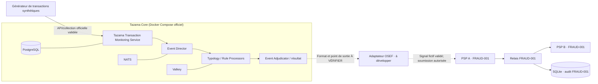

# FRAUD-002 — Détection transactionnelle avec Tazama et interopérabilité avec FRAUD-001

> **Statut : lab proposé / conception documentée ; déploiement et intégration NON testés.**
> **Usage : laboratoire isolé uniquement.** Données entièrement synthétiques, sans PSP bancaire réel.
> **Attention :** ce lab ne constitue pas une implémentation officielle de l'OFTA, ni une preuve de conformité aux réglementations sectorielles.

## 1. Pourquoi un deuxième lab ?

[FRAUD-001](../FRAUD-001/README.md) permet de **partager des signaux antifraude** entre deux PSP fictifs via un relais. Il ne réalise **aucune détection transactionnelle réelle**.

**FRAUD-002** poursuit une compétence différente :
1. Exécuter une pile **Tazama** dans un environnement de démonstration.
2. Fournir des **événements de paiement fictifs** à son pipeline de surveillance transactionnelle selon les interfaces officiellement documentées.
3. Examiner les décisions/résultats générés par la configuration de démonstration.
4. Implémenter, en phase d'intégration, un **adaptateur OSEF** qui transforme **uniquement les résultats autorisés** en signaux compatibles avec le relais FRAUD-001.
5. Prouver qu'aucune donnée sensible ne traverse le relais et qu'un PSP non autorisé ne peut accéder aux alertes.

**Important :** les alertes de Tazama et les signaux FRAUD-001 n'ont pas d'équivalence de schéma confirmée. Le mapping et le protocole restent un livrable à réaliser, pas une intégration déjà disponible.

## 2. Architecture de référence — cible, non déployée



Les flèches pointillées sont **des interfaces projetées et non implémentées**. La structure interne est une simplification pédagogique de la chaîne de traitement Tazama ; il faut confirmer les flux précis avec la version déployée.

### Frontières de confiance

- **Domaine Tazama** : événements de transactions de laboratoire et calcul de résultats de détection.
- **Adaptateur OSEF** : transforme un résultat vérifié en message de signalement minimal ; applique une allowlist de catégories et une politique de partage.
- **Domaine FRAUD-001** : transit et consultation autorisés des signaux ; pas de moteur de scoring.
- **Aucune connexion** à un PSP, banque, switch, mobile money ou registre de fraude réel.

## 3. Technologies open source et responsabilités

| Couche | Technologie | Rôle |
|---|---|---|
| Surveillance transactionnelle | **Tazama Core** | Pipeline de surveillance des événements |
| API d'entrée Tazama | **Transaction Monitoring Service (TMS)** | Point d'entrée officiel de la pile |
| Messagerie de la pile Tazama | **NATS** | Distribution asynchrone interne |
| État / configuration | **PostgreSQL** | Persistance de la stack |
| Cache | **Valkey** | Cache pour les traitements |
| Traitement | **Rule / Typology Processors** | Détection selon règles et typologies de démonstration |
| Contrôle de l'accès (optionnel) | **Keycloak** | Authentification selon configuration upstream |
| Relais de signaux | **FRAUD-001 / FastAPI** | Échange inter-PSP simulé |
| Persistance du relais | **SQLite** | Audit et signaux de FRAUD-001 |
| Adaptateur (à écrire) | **Python + HTTPX + Pydantic** | Traduction, minimisation et validation des événements |
| Déploiement local | **Docker Engine + Compose v2** | Sandbox reproductible |

La stack Tazama actuelle présente aussi les **extensions** (configuration studios, case management) et **BIAR** (analytics/reporting), mais **elles ne sont pas nécessaires pour le premier objectif de FRAUD-002**. Vérifier licences et conditions d'accès aux différents composants et images avant installation. Certains processeurs de règles peuvent avoir un accès conditionné ; ne pas les qualifier de libres d'accès sans vérification.

> **Décision du 18 novembre 2026 : Option B retenue — une seule VM `osef-fraud-01` redimensionnée pour FRAUD-001 + FRAUD-002.** [Procédure opérationnelle détaillée : sauvegarde, VirtualBox, agrandissement disque, contrôle Ubuntu et tests de non-régression](OPTION-B-REDIMENSIONNEMENT-VM.md). La taille cible de départ (4 vCPU / 12 Gio / 80 Go) dépend de la capacité du laptop Windows ; **aucune modification de la VM n'est encore confirmée**.

## Deux architectures VirtualBox possibles

Le lab peut être déployé selon **deux options documentées** :

1. **Deux VM séparées (recommandée si le PC hôte le permet)** : conserver `osef-fraud-01` (FRAUD-001, 2 vCPU / 4 Gio / 25 Go) ; créer `osef-fraud-02` pour Tazama Core (point de départ OSEF : **4 vCPU / 12 Gio / 80 Go**).
2. **Une seule VM redimensionnée** : conserver `osef-fraud-01` mais passer, selon la capacité du PC, à **4–6 vCPU / 12–16 Gio / 80–100 Go** avec sauvegarde, arrêt, extension du VDI, extension contrôlée de la partition et revérification T01–T10.

Ces chiffres sont des **estimations de laboratoire non garanties par Tazama**. Le PC physique et les consommations réelles restent à mesurer. La version Core inspectée est `83e4b12c16986aedfff843ed84b7045ac912ec0a`, avec 13 services prévus dans le profil Public (DockerHub).

➡️ **[Guide complet : dimensionnement, choix, procédures VirtualBox/Ubuntu, réseau, sauvegardes et critères de validation](DIMENSIONNEMENT-VIRTUALBOX.md)**.

## 4. Matériel et environnement

### Séparer les phases

- **Phase A (FRAUD-001 seul)** : une VM Ubuntu de départ à 2 vCPU / 4 Gio RAM peut servir d'essai, sans garantie de performances.
- **Phase B (Tazama Core)** : la pile officielle comprend plusieurs composants et peut demander bien plus de RAM/CPU/disque. **Aucun minimum matériel fiable pour une VM VirtualBox n'est confirmé dans cette fiche**. Ne pas présenter la VM FRAUD-001 de 4 Gio comme suffisante.
- **Phase C (cohabitation FRAUD-001 + Tazama)** : vérifier les **ports** et ressources, ainsi que les réseaux, avant tout lancement simultané. Utiliser une VM distincte pour Tazama si la VM initiale est insuffisante.

**Pré-requis communs :** Ubuntu récent, Docker/Compose, Git, curl, accès Internet, espace pour images Docker et volumes. Un compte GitHub/jeton `read:packages` peut être requis selon les images choisies dans la stack officielle ; garder le jeton hors des dépôts. Ne pas exposer les ports de la stack à Internet.

## 5. Procédure détaillée — Phase A : vérifier FRAUD-001

Lire [le guide VirtualBox + Ubuntu](../FRAUD-001/VIRTUALBOX-UBUNTU.md). Dans la VM :

```bash
# Récupérer les labs OSEF.
git clone https://github.com/opensource-enterprise-factory/osef-open-source-payment-banking-labs.git
cd osef-open-source-payment-banking-labs/labs/FRAUD-001

# Préparer les secrets non versionnés et contrôler la syntaxe Compose.
bash scripts/init-env.sh
sudo docker compose config --quiet

# Démarrer FRAUD-001, puis exécuter les scénarios de base.
sudo docker compose up --build -d
bash scripts/test-lab.sh

# Arrêter pour libérer les ressources avant Tazama.
sudo docker compose down
```

**Gate A :** conserver preuves T01–T07 ; ne pas poursuivre si l'authentification ou la séparation des rôles ne fonctionne pas.

## 6. Procédure détaillée — Phase B : déployer Tazama Core

**Documentation officielle à suivre :**
- [Tazama Stack](https://github.com/tazama-lf/tazama-stack)
- [README Core officiel](https://github.com/tazama-lf/tazama-stack/blob/main/core/README.md)

**Attention à l'incohérence du dépôt upstream :** le README `core/README.md` cite `./tazama.sh`, mais l'arborescence actuelle de la branche `main` contient **`core/tazama-core.sh`**, sans `tazama.sh` à la racine. **Vérifier le fichier réellement présent dans le clone avant de le lancer** ; utiliser `bash ./tazama-core.sh` depuis le répertoire `core` si le clone correspond à l'arborescence inspectée. La stack officielle sert à la démonstration et aux tests, pas à la production. Ne pas supposer que les 4 Gio de RAM de FRAUD-001 suffiront.

### B1. Pré-contrôle non destructif de la VM

Depuis le dossier OSEF `labs/FRAUD-002` :

```bash
# Affiche l'OS, les vCPU, la RAM, le disque, les ports et les versions Docker/Compose.
# Ne lance pas Tazama, n'altère pas la configuration de la machine.
bash scripts/preflight.sh
```

Le script signale les dépendances absentes mais **ne garantit pas la capacité de la VM à faire tourner Tazama**. Conserver sa sortie sans informations sensibles dans le compte rendu du lab.

### B2. Cloner la pile et inspecter ses options

```bash
# Télécharger uniquement les sources officielles.
git clone --branch main https://github.com/tazama-lf/tazama-stack.git
cd tazama-stack

# Capturer le commit pour reproductibilité.
git rev-parse HEAD

# Lire les prérequis et la procédure correspondant au commit obtenu.
less core/README.md

# Vérifier les lanceurs réellement disponibles dans ce commit.
ls -l ./tazama.sh ./core/tazama-core.sh 2>/dev/null || true
# Inspecter le script réellement présent avant de l'exécuter.
less core/tazama-core.sh
```

Le menu officiel présente notamment **Public (GitHub)**, **Public (DockerHub)**, **Full-service (DockerHub)** et **Multi-Tenant Public (DockerHub)**. Pour un premier essai limité, privilégier **Public (DockerHub)** après lecture du menu, car l'upstream précise que cette option déploie les services de base et un processeur de règle d'exemple. **Ne pas sélectionner une configuration multi-tenant ou full-service par défaut.**

### B3. Prendre connaissance des secrets et de l'exposition réseau

La procédure upstream peut exiger un **jeton GitHub `read:packages`** pour récupérer des images hébergées dans GHCR ; cela dépend de l'option de déploiement choisie. Si ce cas se présente, suivre la documentation Tazama et utiliser `docker login ... --password-stdin` **sans écrire le jeton dans le dépôt ni le fichier .env**.

**Attention :** vérifier les ports publiés par chaque fichier Compose Tazama avant de l'exécuter. L'environnement initial n'a pas la garantie de se limiter à `127.0.0.1`. Pour ce lab, employer une VM isolée, sans redirection de ports depuis la box/routeur vers Internet.

### B4. Lancer le menu officiel sur Linux

```bash
# À la racine du clone tazama-stack, et seulement après revue du README :
# Pour l'arborescence actuellement observée sur GitHub :
cd core
bash ./tazama-core.sh
```

Sélectionner l'option documentée, noter le choix et les addons. Les composants tels que Keycloak, relay services, pgAdmin et Hasura varient selon le mode choisi. Les tests officiels peuvent dépendre de services relais NATS : suivre les recommandations associées à la collection Postman choisie.

### B5. Vérifier le déploiement avec la procédure upstream

Consulter la section « Testing the end-to-end deployment » du README officiel et utiliser **les URL, ports, identifiants fictifs et jeux de tests indiqués pour le commit déployé**. Ne pas supposer qu'un endpoint `/health` ou un port fixe sera identique à travers toutes les options de déploiement.

**Preuves à consigner :**
- commit Git de `tazama-stack`, mode du menu choisi et version des images ;
- `docker compose ps` ou commande prescrite par le script, avec statut des services ;
- mémoire et espace disque avant/après ;
- réponse des points de contrôle documentés ;
- un jeu de tests officiel exécuté et résultats expurgés ;
- incidents et correctifs, **sans aucun secret**.

**Gate B :** la stack est démarrée et une vérification de bout en bout de l'upstream a effectivement réussi, avec preuves. Si cette étape échoue, ne pas développer l'adaptateur sur des hypothèses.

## 7. Phase C : comprendre le format transactionnel de Tazama

Le schéma du message **ne doit pas être inventé** à partir des champs de FRAUD-001. Utiliser les collections de test / exemples upstream **pour le commit choisi** :

1. Localiser les collections Postman et fichiers d'environnement cités dans `core/README.md`.
2. Inspecter le contrat exact de l'API du TMS, les types d'événements et l'authentification.
3. Utiliser le jeu de données **synthétique** fourni par le projet ou un jeu de test conforme.
4. Exécuter **un** scénario nominal et **un** scénario provoquant la règle de démonstration.
5. Collecter la réponse API et la sortie réellement observée (event adjudicator, message, API, autre canal documenté).
6. Produire un tableau `champ émis / signification / confidentialité / destination / rétention`.

**Gate C :** preuve de traitement de transactions synthétiques par la pile ; identification vérifiée du résultat exploitable par un futur adaptateur.

## 8. Phase D : spécifier puis développer l'adaptateur OSEF

Ne pas supposer qu'il existe déjà un webhook directement exploitable, ni accéder aux bases internes Tazama par requêtes improvisées.

### Contrat cible minimal — spécification OSEF

```json
{
  "transaction_token": "demo-transaction-001",
  "category": "suspicious-transfer",
  "severity": "high",
  "recipient": "psp-b",
  "expires_in_hours": 1
}
```

Il s'agit du **schéma d'entrée de FRAUD-001**, **pas d'un schéma officiel Tazama/OFTA**.

L'adaptateur devra :
- Lire un **résultat Tazama confirmé par la documentation** via une interface explicitement choisie.
- Mettre en correspondance le résultat avec les catégories et niveaux de gravité acceptés, selon une politique documentée.
- Produire un jeton purement synthétique `demo-`, sans PAN, MSISDN, numéro de compte ni identifiant personnel.
- Ne partager que les **événements explicitement autorisés** dans le périmètre pédagogique.
- Garantir authentification, journalisation sans secrets, validation de schéma, dédoublonnage et gestion d'erreur.
- Conserver le droit d'une revue humaine pour éviter de confondre signal de risque et fraude avérée.
- **Ne pas** faire de décision de blocage de paiement sur la base du seul signal échangé.

Le point de sortie Tazama, les noms de messages et le mappage ne seront codés **qu'après validation des sources et d'un événement réel de laboratoire**.

## 9. Scénarios de tests d'acceptation

| ID | Test | Preuve / attendu | Statut |
|---|---|---|---|
| F2-01 | Tazama Core démarré | Healthcheck conforme à upstream | À exécuter |
| F2-02 | Flux de transaction fictive nominal | Traitement documenté | À exécuter |
| F2-03 | Scénario de règle de démo | Résultat de surveillance observé | À exécuter |
| F2-04 | Résultat mappé en signal FRAUD-001 | Message conforme au schéma OSEF | À développer |
| F2-05 | Aucune donnée sensible transférée | Tests d'allowlist et audit | À développer |
| F2-06 | Lecture réservée au PSP B | Refus de rôle non autorisé | À développer |
| F2-07 | Doublon | Traitement idempotent / HTTP 409 documenté | À développer |
| F2-08 | Source Tazama indisponible | Aucune alerte inventée ; erreur explicite | À développer |
| F2-09 | Adaptateur / relais indisponible | Retour contrôlé et absence de double livraison | À développer |
| F2-10 | Durée de vie / purge des signaux | Rétention documentée et testée | À développer |

Aucun test F2-01–F2-10 n'est déclaré comme réussi avant publication de preuves.

## 10. Livrables d'ingénierie attendus

- [ ] Environnement Tazama Core reproductible, version/commit figé.
- [ ] Mesures de RAM/CPU/disque de la VM VirtualBox après démarrage.
- [ ] Guide de déploiement Linux commenté et notes de dépannage.
- [ ] Cas de tests transactionnels fictifs issus des exemples officiels.
- [ ] Contrat de sortie réellement observé (sans données sensibles).
- [ ] Tableau de mapping Tazama → signal minimal FRAUD-001.
- [ ] Adaptateur OSEF isolé avec tests unitaires et tests d'intégration.
- [ ] Séparation des rôles, authentification et journal d'audit.
- [ ] Diagramme de séquence et démonstration reproductible.
- [ ] Analyse juridique et de gouvernance : seules des hypothèses, aucune conformité revendiquée.
- [ ] Code/PR relus par un autre ingénieur et rapport des anomalies.

## 11. Découpage en contributions volontaires

1. **Infra / Docker** — installation et mesures de capacité Tazama Core.
2. **Payment Engineer** — contrats d'événements, scénario transactionnel et résultats.
3. **Integration Engineer** — adaptateur et tests d'API.
4. **Security / SRE** — contrôle d'accès, audit, résilience, données et conformité des exemples.

Même ingénieur possible sur plusieurs rôles selon la disponibilité ; aucun responsable n'est encore nommé.

## 12. Liens et traçabilité

- [FRAUD-001 — Issue #43](https://github.com/opensource-enterprise-factory/osef-open-source-payment-banking-labs/issues/43)
- [Meetup FRAUD-001 — Issue #46](https://github.com/opensource-enterprise-factory/osef-open-source-payment-banking-labs/issues/46)
- [Tazama — dépôt officiel](https://github.com/tazama-lf/tazama-stack)
- [Tazama Core — instructions](https://github.com/tazama-lf/tazama-stack/blob/main/core/README.md)
- [Tazama — ressources techniques](https://www.tazama.org/community/technical/)
- [Tazama — documentation](https://github.com/tazama-lf/docs)

**Critère de clôture :** démonstration réelle avec preuves des scénarios, documentation et revue. Une fiche de conception n'est pas une livraison fonctionnelle.

## Pré-déploiement sur VM unique — contrôle des ports

Avant de démarrer les 13 services Tazama sur `osef-fraud-01`, exécuter le **contrôle non destructif versionné**. Le commit de référence Tazama déjà cloné est `83e4b12c16986aedfff843ed84b7045ac912ec0a`.

```bash
# Après revue et fusion de la PR GitHub correspondante :
cd /home/lionel/osef-open-source-payment-banking-labs
git status -sb   # ne rien écraser sur la VM
git checkout main
git pull --ff-only origin main

# Vérification uniquement : n'exécute ni docker compose up ni down.
python3 labs/FRAUD-002/scripts/check-tazama-compose.py
```

Le script inspecte le profil **Public (DockerHub) sans addons facultatifs** et indique : liste des 13 services, ports hôte publiés, restrictions d'écoute, collisions avec les ports FRAUD-001 (8090–8092), limites mémoire déclarées. Il **n'affiche pas les valeurs des variables d'environnement** et ne crée/modifie aucun fichier, volume ou conteneur. **Un code de sortie 1 signale une exposition réseau ou un conflit nécessitant une revue, pas forcément un échec Docker.**

**Constat initial à partir des fichiers upstream inspectés :** PostgreSQL, NATS, Valkey et certaines APIs sont publiés par des mappings sans IP de liaison explicite ; selon la configuration Docker, ces publications peuvent être accessibles depuis les interfaces de la VM, au-delà de localhost. **Ne pas lancer Tazama avant revue d'une restriction à 127.0.0.1 ou à un réseau d'administration autorisé.** La seule absence de collision avec FRAUD-001 ne prouve pas que la configuration est sécurisée.

**Règle OSEF confirmée : toutes les modifications de configuration passent par une PR GitHub ; aucun changement manuel de fichiers sur la VM.** Les commandes de la VM servent à synchroniser et appliquer uniquement le contenu révisé.


## Lancement sécurisé du profil Public (DockerHub) sur une VM unique

**Évolution demandée pour la démonstration sur Windows :** publication sélective de `tazama-demo` sur `192.168.255.10:3011`. Il ne s’agit pas d’un déploiement Internet. Éviter toute donnée réelle ou clé sensible dans le lab.

**Rapport d'audit exécuté sur `osef-fraud-01` :** 13 services, aucune collision 8090–8092, mais **9 publications sur l'interface hôte par défaut** (admin, batch, PostgreSQL, trois ports NATS, démonstration web, TMS, Valkey) et aucune limite mémoire explicite. Les résultats proviennent de `python3 labs/FRAUD-002/scripts/check-tazama-compose.py`, fournis par l'ingénieur.

**Remédiation OSEF versionnée dans GitHub :**
- [`compose.loopback.yaml`](compose.loopback.yaml) : restreint **8** publications à `127.0.0.1` et la seule interface `tazama-demo` à `192.168.255.10:3011`, avec `ports: !override` (sans laisser subsister les entrées `0.0.0.0` du fichier officiel).
- [`scripts/tazama-safe.py`](scripts/tazama-safe.py) : compose les **cinq fichiers officiels du commit inspecté** et l'overlay OSEF ; refuse un lancement si une IP autre que localhost est publiée, à l’exception contrôlée de `tazama-demo` sur `192.168.255.10:3011`, si un port 8090–8092 est utilisé, ou si la composition n'a pas exactement 13 services et 9 publications attendues.

**Règle de déploiement :** jamais de modification de fichier directement sur la VM. Revue puis fusion de la PR GitHub, suivies d'une synchronisation `git pull --ff-only` sur `main`. Ne pas utiliser directement le lanceur officiel `tazama-core.sh` pour ce profil : il **n'inclut pas l'overlay OSEF** et certaines options déclenchent `down --volumes`.

### Après fusion et synchronisation Git sur Ubuntu

```bash
cd /home/lionel/osef-open-source-payment-banking-labs
git status -sb
git checkout main
git pull --ff-only origin main

# Vérifier la capacité réellement utilisable ; ne poursuivre que si l'extension du système de fichiers est faite.
free -h
df -h /
nproc

# Contrôle sans démarrage : Compose valide, 13 services ; 8 ports locaux et la démo sur Host-only.
python3 labs/FRAUD-002/scripts/tazama-safe.py check

# UNIQUEMENT après validation des ressources et du retour OK :
# python3 labs/FRAUD-002/scripts/tazama-safe.py up

# Inspection de l'état après lancement, puis diagnostic :
# python3 labs/FRAUD-002/scripts/tazama-safe.py ps
# python3 labs/FRAUD-002/scripts/tazama-safe.py logs
```

**Notes d'exploitation :**
- **Seule l’interface Tazama Demo sera accessible depuis Windows** à `http://192.168.255.10:3011/` sur le réseau privé Host-only VirtualBox. Les 8 autres ports restent sur `127.0.0.1` dans la VM. Vérifier que la VM possède toujours l’adresse `192.168.255.10/24` sur `enp0s8` avant `up`, et que le réseau Host-only est réservé à des machines autorisées. Depuis Windows : `Test-NetConnection 192.168.255.10 -Port 3011` puis navigateur `http://192.168.255.10:3011/`. L’accès réel ne sera confirmé qu’après le démarrage et les vérifications.
- `tazama-safe.py` n'efface aucun volume ni fichier ; `up` peut créer les conteneurs, réseaux et volumes du projet `tazama-core`. Il ne démarre jamais FRAUD-001.
- Les images, règles et données du profile upstream restent à tester. Un healthcheck TMS ou des scénarios officiels réussis ne sont **pas encore confirmés**.
- **Ne pas lancer les 13 services avec seulement 25 Go utilisables** : vérifier `df -h /` après redimensionnement avant installation, et surveiller mémoire/stockage.
- Les limites de RAM n'étant pas définies par ces fichiers Compose, procéder à des tests progressifs, surveiller `docker stats --no-stream`, et s'arrêter en cas de pression mémoire.

