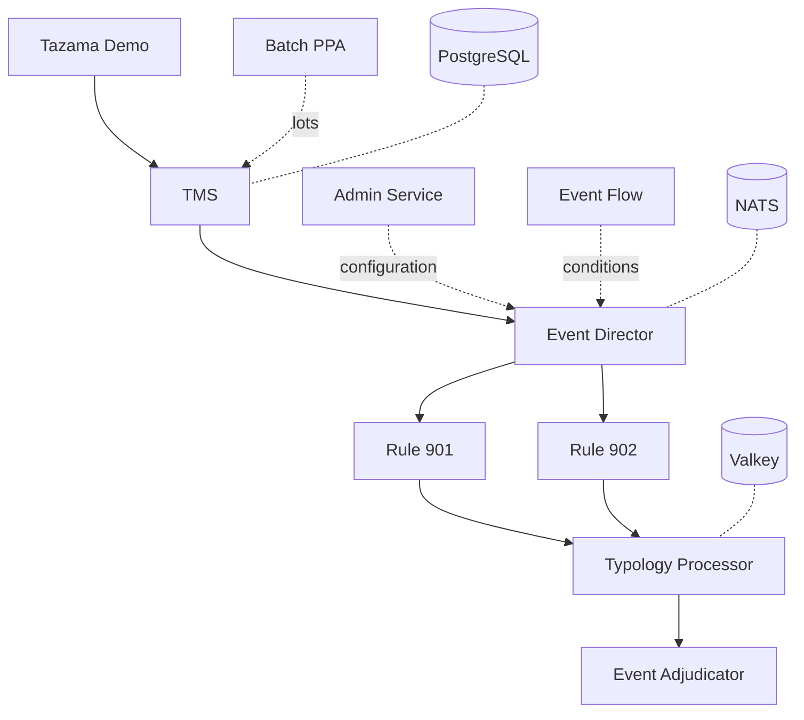

# FRAUD-002 — Comprendre les 13 services Tazama Core

**Périmètre :** profil Public DockerHub de Tazama au commit `83e4b12c16986aedfff843ed84b7045ac912ec0a`, avec overlay OSEF sur `osef-fraud-01`. Usage démonstration uniquement, données synthétiques.

**Preuve du laboratoire (18/11/2026) :** 13 conteneurs `Up`, trois composants `healthy` (Demo, PostgreSQL, Valkey), `batch-ppa` `unhealthy` ; aucun test métier bout en bout encore confirmé.

## Sources officielles et distinction des preuves

- [Tazama Core — Overview of Services](https://github.com/tazama-lf/tazama-stack/blob/83e4b12c16986aedfff843ed84b7045ac912ec0a/core/README.md#4-overview-of-services) : responsabilités fonctionnelles.
- [Fichier Compose Infrastructure](https://github.com/tazama-lf/tazama-stack/blob/83e4b12c16986aedfff843ed84b7045ac912ec0a/core/docker-compose.base.infrastructure.yaml) : PostgreSQL, Valkey, NATS.
- [Fichier Compose Core](https://github.com/tazama-lf/tazama-stack/blob/83e4b12c16986aedfff843ed84b7045ac912ec0a/core/docker-compose.hub.core.yaml) : APIs, processeurs, Batch PPA, Demo.
- [Fichier Compose Rules](https://github.com/tazama-lf/tazama-stack/blob/83e4b12c16986aedfff843ed84b7045ac912ec0a/core/docker-compose.hub.rules.yaml) : Rules 901 et 902.
- [Overlay OSEF](../compose.loopback.yaml) : publications réellement appliquées à cette VM.

## Flux fonctionnel simplifié



**Attention :** la carte décrit une organisation pédagogique, non un trajet réellement tracé ; les règles et routes dépendent de la network map et des configurations chargées. Les flèches en pointillés ne représentent pas des contrats API vérifiés.

## Tableau des 13 services

| # | Service | Fonction principale | Publication hôte OSEF | Dépendances Compose | Observé |
|---|---|---|---|---|---|
| 1 | `tazama-demo` | UI de démonstration | `192.168.255.10:3011` | TMS, Admin, NATS | healthy |
| 2 | `tms-service` | API d'entrée des transactions | `127.0.0.1:5000` | PostgreSQL, Valkey, NATS | Up |
| 3 | `event-director` | Routage selon network map | `aucun` | PostgreSQL, Valkey, NATS | Up |
| 4 | `rule-901` | Exécute la règle 901; logique exacte non vérifiée | `aucun` | PostgreSQL, Valkey | Up |
| 5 | `rule-902` | Exécute la règle 902; logique exacte non vérifiée | `aucun` | PostgreSQL, Valkey | Up |
| 6 | `typology-processor` | Agrège les résultats des règles en typologies | `aucun` | PostgreSQL, Valkey, NATS | Up |
| 7 | `event-adjudicator` | Finalise l'évaluation et publie des alertes | `aucun` | PostgreSQL, Valkey, NATS | Up |
| 8 | `event-flow` | Conditions associées aux comptes et entités | `aucun` | PostgreSQL, Valkey, NATS | Up |
| 9 | `admin-service` | Gestion des configurations et conditions | `127.0.0.1:5100` | PostgreSQL, Valkey | Up |
| 10 | `batch-ppa` | API de prétraitement par lots; comportement détaillé à vérifier | `127.0.0.1:4100` | PostgreSQL, TMS | unhealthy |
| 11 | `nats` | Messagerie pub/sub | `127.0.0.1:14222,16222,18222` | aucune | Up |
| 12 | `valkey` | Cache en mémoire | `127.0.0.1:16379` | aucune | healthy |
| 13 | `core-postgres` | Persistance et migrations | `127.0.0.1:15432` | aucune | healthy |

**Aucun port publié** ne signifie pas absence de réseau Docker. Les dépendances sont celles déclarées par les fichiers Compose, pas nécessairement toutes les dépendances applicatives.

## Fiches pratiques

### 1 — Tazama Demo
Interface de simulation et visualisation. Healthcheck upstream : `http://localhost:3011/api/health` depuis le conteneur. Vérifier avec `docker logs --tail 80 tazama-demo` et `curl -i http://192.168.255.10:3011/api/health`. L'affichage de la page ne prouve pas qu'une transaction a été évaluée.

### 2 — Transaction Monitoring Service
API d'entrée officielle des transactions. Diagnostic : `curl -i http://127.0.0.1:5000/`, `docker logs --tail 80 tms-service`. Dans les logs observés, NATS et bases semblent connectés, mais `Authentication is DISABLED`. Garder les API uniquement sur localhost pour ce labo.

### 3 — Event Director
Oriente les messages selon la network map. Diagnostic : `docker logs --tail 80 event-director`. Connexion NATS observée, traitement de transaction encore non prouvé.

### 4 — Rule 901
Processeur de règle ; lire `docker logs --tail 80 rule-901`. Nature, seuils et champs de la règle **non vérifiés** ; ne pas supposer qu'il s'agit de vélocité ou de montant.

### 5 — Rule 902
Deuxième processeur ; lire `docker logs --tail 80 rule-902`. Nature, seuils et champs **non vérifiés**.

### 6 — Typology Processor
Synthétise les résultats des règles en scénarios selon la configuration des typologies. Diagnostic : `docker logs --tail 80 typology-processor`. Vérifier les typologies effectivement chargées.

### 7 — Event Adjudicator
Finalise l'évaluation et publie les alertes des typologies déclenchées. Diagnostic : `docker logs --tail 80 event-adjudicator`. Sortie et schéma à confirmer avant adaptation vers FRAUD-001.

### 8 — Event Flow
Prend en charge des conditions propres aux comptes ou entités. Diagnostic : `docker logs --tail 80 event-flow`. Conditions activées dans le profil à vérifier.

### 9 — Admin Service
Gère conditions et configurations. Diagnostic : `docker logs --tail 80 admin-service`. Pas de modification en base sans procédure validée.

### 10 — Batch PPA
Nom du composant dans le Compose officiel : `BATCH PRE-PROCESSING API`. État **unhealthy** rapporté, cause inconnue. Lire les détails du healthcheck et les logs avant toute hypothèse.

```bash
docker inspect batch-ppa --format '{{json .State.Health}}' | python3 -m json.tool
docker logs --tail 100 --timestamps batch-ppa
docker inspect batch-ppa --format 'Status={{.State.Status}} Restarts={{.RestartCount}} ExitCode={{.State.ExitCode}}'
```

### 11 — NATS
Bus pub/sub. Image observée `nats:2`. Diagnostic : `docker logs --tail 80 nats`. Connexion positive de certains processeurs observée, livraison des messages non encore vérifiée.

### 12 — Valkey
Cache mémoire, image `valkey/valkey:7.2.5`, healthcheck upstream `valkey-cli -p 6379 ping | grep PONG`. Diagnostic : `docker inspect valkey --format '{{.State.Health.Status}}'`.

### 13 — Core PostgreSQL
Persistance, image `postgres:18`, healthcheck upstream `pg_isready -U postgres`. Diagnostic : `docker inspect core-postgres --format '{{.State.Health.Status}}'`. Schémas et rétention spécifiques à inspecter.

## Trois niveaux de validation

1. **Infrastructure :** conteneurs démarrés et ports cohérents — validé.
2. **Santé applicative :** partiellement validée ; `batch-ppa` unhealthy.
3. **Métier :** transaction de bout en bout, évaluation des règles, typologies, décision — **pas encore validée**.

## Contribuer à Tazama upstream

**Pistes à qualifier, et non bugs confirmés :** (1) comportement unhealthy de Batch PPA avec images `rc`, (2) documentation des treize services et des healthchecks, (3) avertissements sur la publication des ports et l'authentification désactivée en mode démo.

Pour chacune : vérifier version et dépôt source, comportement attendu/observé, étapes reproductibles, logs sans secrets, issues et PR existantes, puis proposer discussion/issue/PR conformément aux règles des mainteneurs.

## Prochain exercice

Diagnostiquer Batch PPA en lecture seule, puis utiliser la [collection officielle Postman/Newman du profil Public DockerHub](https://github.com/tazama-lf/postman) selon le [README Tazama §5](https://github.com/tazama-lf/tazama-stack/blob/83e4b12c16986aedfff843ed84b7045ac912ec0a/core/README.md#5-testing-the-end-to-end-deployment). Ne pas présenter la réussite de ces tests avant exécution.

**Règle OSEF :** toute modification de code, configuration ou documentation passe par une branche et une Pull Request GitHub. Aucun fichier n'est modifié directement sur la VM.