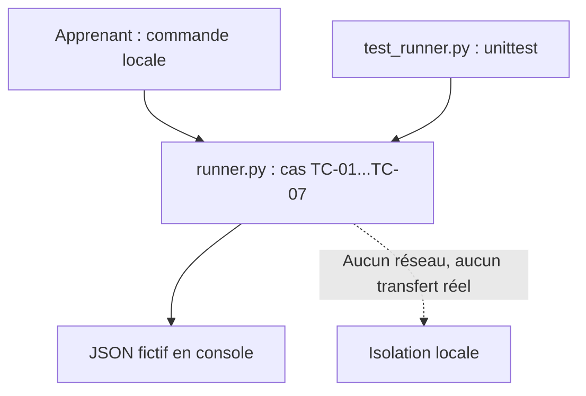

# OSEF Academy — Sept mini-labs exécutables du tronc commun

**Version 0.1 — 17 novembre 2026.** Sept démonstrations autonomes partageant un moteur Python et une suite de tests unitaires. **Le code et les tests sont publiés, mais leur réussite n'est pas encore attestée par une exécution CI ou une revue indépendante.**

## Démarrer

**Prérequis :** Python 3.10+, Git pour les contributions. Aucune dépendance tierce, aucun accès Internet pour exécuter les scripts une fois le dépôt obtenu.

```bash
# Depuis le répertoire racine du dépôt, vérifie la version Python.
python3 --version

# Exécute une seule démonstration (exemple : tronc commun TC-04).
python3 labs/common-core/runner.py TC-04

# Exécute les tests unitaires des sept exercices.
python3 -m unittest discover -s labs/common-core -p 'test_*.py' -v

# Contrôle les fichiers modifiés avant toute contribution GitHub.
git status
```

**Sur Windows :** `py -3` peut remplacer `python3`. La CI GitHub ci-dessous est une configuration à exécuter, pas une preuve de succès.

## Catalogue

| Lab | Exercices | Description |
|---|---|---|
| [TC-01](TC-01.md) | Hash SHA-256 | Empreinte déterministe de données fictives |
| [TC-02](TC-02.md) | API mock | Requêtes et réponses **en mémoire**, aucun serveur HTTP |
| [TC-03](TC-03.md) | États | Reçu, approuvé, refusé, inconnu |
| [TC-04](TC-04.md) | Ledger de démonstration | Double écriture et idempotence, sans monnaie réelle |
| [TC-05](TC-05.md) | Sécurité | Autorisation pédagogique et logs expurgés |
| [TC-06](TC-06.md) | Résilience | Timeout inconnu et résolution de statut |
| [TC-07](TC-07.md) | BDAT | Quatre couches et note de décision |

**Code :** [runner.py](runner.py) · **Tests :** [test_runner.py](test_runner.py) · **Modèle de preuve :** [EVIDENCE-TEMPLATE.md](EVIDENCE-TEMPLATE.md).

## Architecture de démonstration



Les fonctions ne simulent qu'un **sous-ensemble simplifié** des disciplines de paiement. Le mock TC-02 n'est pas une API REST opérationnelle ; les chaînes de TC-05 ne sont pas des jetons d'authentification sûrs. Le ledger TC-04 ne peut pas être réutilisé comme produit financier.

## Évaluation et preuves

1. Exécuter un ou plusieurs labs et consigner **la vraie sortie** du programme.
2. Choisir un cas d'erreur, compléter ou corriger un test unitaire.
3. Produire un bref diagramme, expliquer les limites et renseigner le modèle de preuve.
4. Soumettre une PR et demander une revue.

Un lab **documenté** ne vaut pas lab **validé** : l'état de chaque exercice sera actualisé uniquement après vérification de l'exécution et de la revue.

## Sécurité et licence

Les exemples sont **strictement synthétiques** : pas de PAN, PIN, CVV, identifiant de compte réel, monnaie ou connecteur vers un système financier. Consulter [SECURITY.md](../../SECURITY.md) et [CONTRIBUTING.md](../../CONTRIBUTING.md). La licence du dépôt et les obligations sur d'éventuelles dépendances sont à vérifier avant toute réutilisation externe.

[Tronc commun pédagogique](../../docs/academy/tronc-commun/README.md) · [Catalogue général](../README.md)

**English:** Seven offline, standard-library Python teaching exercises. Source code is committed, execution evidence and independent reviews remain to be confirmed. Not production-grade financial software.
